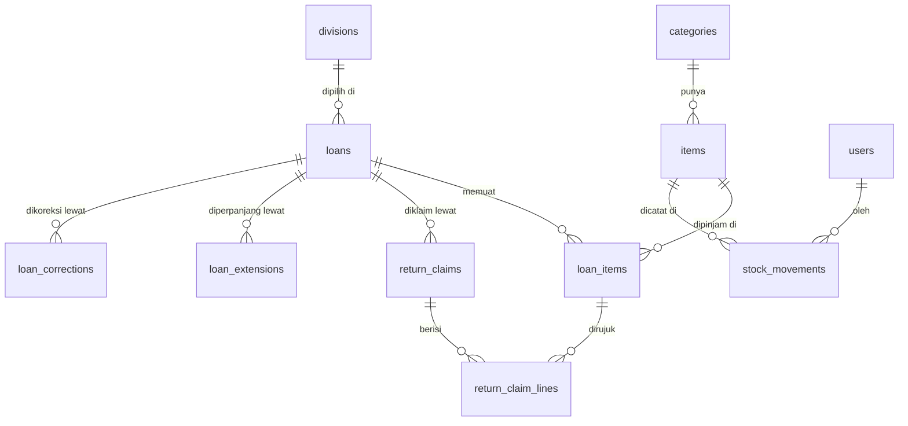

# PRD: Sistem Peminjaman & Inventaris Barang Tim IT (Versi Laravel)

Versi dokumen 0.1 (draf untuk ditinjau) · 21 Oktober 2026 · Tahap B

Sumber: branch v5 repo Peminjaman_investaris (PRD v5.3, SYSTEM-DESIGN v1.3, audit kode) dan keputusan pengguna.

**Penanda status.** **[T]** = terverifikasi di dokumen atau kode repo. **[U]** = usulan baru dalam PRD ini. **[K]** = perlu konfirmasi Anda sebelum final.

---

## Keputusan yang menjadi dasar PRD

| No. | Keputusan | Sumber |
|---|---|---|
| 1 | Aplikasi dibangun dengan Laravel 13 sebagai API di folder `backend` dan frontend Vue dengan Tailwind CSS di folder `frontend` (pilihan A, 22 Okt 2026) | Pengguna, 21 Okt 2026 |
| 2 | Peminjam tidak memakai akun. Hanya admin yang login | Pengguna, 21 Okt 2026 |
| 3 | Database MySQL (InnoDB). Lingkungan: PHP 8.4.16, MySQL 8.4.3 di PHPBRO (menggunakan Adminer) | Repo D-13, hasil pengecekan |
| 4 | Aturan bisnis (BR-01 sampai BR-33) dan skema 14 tabel dari repo diadopsi sebagai acuan, lalu disesuaikan ke Laravel | Repo [T] |

**[K] Penyimpangan dari keputusan tim.** Dokumen repo menetapkan backend Node.js + TypeScript. PRD ini memakai Laravel sesuai permintaan Anda. AGENTS.md di repo meminta perbedaan seperti ini dibicarakan dengan pemilik repo dan pengembang lain sebelum dikodekan.

---

## 6.1 Informasi Produk

| Item | Isi |
|---|---|
| Nama aplikasi | Sistem Peminjaman & Inventaris Barang Tim IT |
| Tujuan | Mencatat peminjaman dan pengembalian barang IT secara akurat, menggantikan buku catatan, dengan stok yang hanya berubah lewat transaksi tervalidasi di server |
| Latar belakang | Pencatatan manual rawan salah. Prototipe yang ada belum aman dan belum konsisten (lihat 6.2) |
| Target pengguna | Peminjam (karyawan dari semua divisi), admin/petugas inventaris tim IT, pembaca laporan (kepala tim IT) |
| Platform | Web, dijalankan di jaringan lokal kantor pada satu PC khusus yang menyala selama jam operasional |
| Teknologi | Backend: Laravel 13 (API JSON), PHP 8.4, MySQL 8.4 di PHPBRO (menggunakan Adminer). Frontend: Vue dengan Vite dan Tailwind CSS di folder `frontend` terpisah. Git, VS Code |
| Mode | **Kiosk** (layar sentuh, tanpa login) dan **Panel Admin** (wajib login) |

---

## 6.2 Problem Statement

**Masalah di lapangan [T].** Peminjaman barang IT dicatat di buku. Data sulit dicari, stok sulit diverifikasi, dan keterlambatan tidak terlacak.

**Masalah pada aplikasi lama [T, terverifikasi dari kode dan audit repo]:**

- Logika stok dihitung di browser, bukan di server.
- Dua endpoint tanpa autentikasi dan tanpa validasi. Siapa pun yang menjangkau port 3001 dapat menimpa seluruh data.
- Sinkronisasi menimpa seluruh array dan polling tiap 3 detik, sehingga rawan hilang data saat dua orang bertransaksi bersamaan.
- Password admin dibandingkan sebagai teks biasa. Sesi disimpan di localStorage tanpa kedaluwarsa. Kredensial bawaan tercantum di kode, form login, dan README.
- Pengembalian langsung menambah stok tanpa pemeriksaan fisik. Pencarian peminjam memakai nama atau divisi sehingga data orang lain terlihat.
- Kode pengujian ikut masuk ke bundle produksi.

**Dampak.** Stok bisa tidak cocok dengan fisik, data bisa hilang atau dimanipulasi, dan privasi peminjam tidak terjaga.

**Kebutuhan pengguna.** Peminjam butuh proses cepat dan tahu batas waktu. Admin butuh kontrol atas stok dan verifikasi barang yang kembali. Pembaca laporan butuh rekap yang akurat.

---

## 6.3 Product Goals

| ID | Tujuan | Ukuran keberhasilan |
|---|---|---|
| G1 | Stok selalu konsisten | Invarian BR-01 lolos pada uji acak minimal 1.000 operasi berturut-turut. Perintah pemeriksaan invarian melaporkan 0 pelanggaran [U] |
| G2 | Tidak ada peminjaman melebihi stok walau bersamaan | Uji konkurensi dengan dua permintaan serentak pada barang berstok 1 menghasilkan tepat satu transaksi berhasil [U] |
| G3 | Akses admin aman | 100% rute admin menolak akses tanpa login. Tidak ada kredensial di repo atau UI [U] |
| G4 | Peminjaman cepat | Peminjam menyelesaikan form hingga mendapat kode pinjam kurang dari 2 menit pada uji penerimaan [U, K] |
| G5 | Laporan dapat diandalkan | Tiga laporan PDF (rekap, belum dikembalikan, stok dan kondisi) sesuai data dan filter [T dari repo] |
| G6 | Mudah dipasang | Aplikasi berjalan dari repo bersih dengan `composer install`, `.env`, dan `php artisan migrate --seed` [U] |

---

## 6.4 Scope

**Pembagian fase [U, K].** Skema database dibuat lengkap sejak awal agar tidak ada migrasi ulang besar. Yang dibagi adalah fitur yang dibangun lebih dulu.

### Fitur wajib MVP (Must)

- Katalog kiosk dengan pencarian dan filter kategori.
- Form peminjaman (tanggal pinjam hari ini) dengan kode pinjam acak dan struk.
- Cek peminjaman lewat kode pinjam.
- Klaim pengembalian oleh peminjam dan verifikasi oleh admin (baik, rusak, hilang, ditolak).
- Login admin, sesi idle 15 menit, pembatasan percobaan login.
- Kelola barang, kategori, dan divisi.
- Penyesuaian stok oleh admin dengan alasan.
- Daftar peminjaman admin dengan filter, detail, dan dasbor.
- Laporan PDF.
- Buku besar stok dan audit log.

### Pengembangan lanjutan (Should dan Could)

- Pemesanan (tanggal pinjam di masa depan) dan pembatalannya.
- Perpanjangan oleh peminjam dan oleh admin.
- Pembatalan peminjaman dan koreksi data oleh admin.
- Penanganan stok rusak (perbaikan dan afkir, mutasi TANDAI_RUSAK).
- Pengaturan parameter dari UI dan pengelolaan akun admin.
- Idle reset kiosk, ekspor CSV/Excel.

### Di luar ruang lingkup [T]

Notifikasi WhatsApp/email, barcode/QR, nomor seri per unit, kalender ketersediaan, konfirmasi pengambilan dan pelepasan otomatis pemesanan, master data karyawan, banyak level peran admin, foto barang, denda, dan **persetujuan peminjaman sebelum barang diambil**.

Catatan: karena persetujuan sebelum pengambilan di luar cakupan, "Setujui/Tolak" pada master prompt dipetakan ke **verifikasi pengembalian** oleh admin.

---

## 6.5 Role dan Hak Akses

**Role final [T, sesuai keputusan Anda dan PRD repo]:** Peminjam (tanpa akun) dan Admin (satu level). Pembaca laporan menerima PDF dari admin dan tidak punya role sendiri. Banyak level admin di luar cakupan.

| Fitur | Peminjam (kiosk) | Admin |
|---|---|---|
| Lihat katalog dan stok | Lihat | Lihat |
| Ajukan peminjaman | Buat | – |
| Pemesanan | Buat, batalkan miliknya sebelum tanggal pinjam | Batalkan (belum ada klaim, alasan wajib) |
| Cek peminjaman | Lihat milik kode yang dimasukkan | Lihat semua |
| Perpanjangan | Ajukan sesuai aturan | Perpanjang tanpa kuota, alasan wajib |
| Klaim pengembalian | Ajukan | – |
| Verifikasi klaim | – | Verifikasi |
| Kelola barang | – | CRUD (hapus = soft-delete) |
| Penyesuaian stok, perbaikan, afkir | – | Ya |
| Kategori dan divisi | Lihat pilihan | CRUD (nonaktifkan, tidak dihapus) |
| Koreksi peminjaman | – | Ya, alasan wajib |
| Laporan PDF | – | Ya |
| Pengaturan parameter | – | Ya |
| Audit log | – | Lihat |
| Akun admin | – | Kelola, plus reset lewat perintah artisan |

---

## 6.6 Functional Requirements

Legenda MoSCoW: M = Must, S = Should, C = Could. Aktor P = Peminjam, A = Admin, S = Sistem. Kolom BR merujuk aturan bisnis repo [T]. Setiap requirement memuat tujuan lewat nama fiturnya, dan alur alternatifnya adalah penolakan validasi yang tercantum.

| ID | Fitur | Aktor | Prasyarat | Alur utama dan alternatif | Validasi (server) | Kriteria penerimaan | Pri. |
|---|---|---|---|---|---|---|---|
| FR-01 | Katalog dan cek stok | P | Barang aktif ada | Buka kiosk, cari nama atau filter kategori, lihat stok. Alt: stok 0 tidak dapat dipilih | Kategori aktif (BR-31) | Pencarian menampilkan hasil sesuai. Barang stok 0 tidak bisa ditambahkan | M |
| FR-02 | Form peminjaman | P | Ada stok | Pilih barang dan jumlah, isi nama, divisi, tipe peminjam, telepon (opsional), batas kembali. Sistem membuat transaksi, mengurangi stok, menampilkan kode PJM-XXXXXX dan struk. Alt: klik ganda tidak membuat transaksi kedua | BR-02, 20, 22, 23, 30, 27. Jumlah ≤ tersedia, minimal 1 barang, tanpa barang ganda | Stok berkurang tepat sejumlah dipinjam. Kode unik tampil. Melebihi stok ditolak dengan pesan jelas | M |
| FR-03 | Pemesanan dan pembatalan | P | Tanggal pinjam ≤ hari ini + batas booking | Pilih tanggal pinjam masa depan. Stok ditahan saat dipesan. Batalkan sebelum tanggal pinjam | BR-24, 26 | Pembatalan mengembalikan stok dan tercatat di buku besar | S |
| FR-04 | Cek peminjaman dengan kode | P | Punya kode | Masukkan kode, lihat kartu peminjaman dan batas waktu. Alt: kode salah | BR-18. Terkunci setelah 5 gagal beruntun selama 5 menit. Telepon tidak pernah tampil | Kode salah tidak membocorkan data. Kunci muncul setelah ambang | M |
| FR-05 | Klaim pengembalian parsial | P | Tanggal pinjam ≤ hari ini, ada sisa unit | Pilih jumlah dan kondisi (baik, rusak, hilang) per barang, kirim, dapat kode KMB-XXXXXX. Stok tidak berubah | BR-03, 04, 10. Jumlah ≤ sisa | Unit pindah ke menunggu verifikasi. Total, tersedia, rusak tetap | M |
| FR-06 | Verifikasi klaim | A | Ada klaim menunggu | Periksa fisik, bagi tiap baris ke baik, rusak, hilang, ditolak, simpan. Alt: hasil berbeda dari laporan wajib catatan | BR-05, 06, 07, 08. Jumlah empat hasil = jumlah baris klaim. Klaim terverifikasi tidak bisa diverifikasi ulang (409) | Stok berubah sesuai hasil. Mutasi tercatat. Verifikasi kedua ditolak | M |
| FR-07 | Perpanjangan oleh peminjam | P | Belum terlambat, kuota tersisa | Masukkan kode, pilih tambahan hari. Batas baru = batas lama + tambahan | BR-11, 12. Semua barang bertanda boleh diperpanjang | Batas baru benar. Syarat tak terpenuhi ditolak | S |
| FR-08 | Perpanjangan oleh admin | A | Peminjaman aktif | Pilih peminjaman, isi hari dan alasan | BR-13. Alasan wajib | Tercatat dengan pelaku admin | S |
| FR-09 | Pembatalan oleh admin | A | Belum ada klaim | Batalkan dengan alasan, stok kembali | BR-25 | Status Dibatalkan, stok kembali, tercatat | S |
| FR-10 | Koreksi peminjaman | A | Peminjaman ada | Ubah nama, divisi, telepon, tanggal, jumlah, isi alasan | BR-16. Jumlah hanya jika belum ada klaim pada barang itu | Riwayat koreksi tersimpan di tabel khusus, bukan di kolom catatan | S |
| FR-11 | Login admin | A | Akun ada | Login email dan password. Idle 15 menit mengeluarkan sesi. Alt: salah password | BR-19. Pembatasan percobaan login. Tanpa registrasi publik | Rute admin tanpa login dialihkan ke login (T-5.1) | M |
| FR-12 | Kelola barang | A | Login | Tambah, ubah, hapus. Stok tersedia awal = total | BR-14, 33. Tidak bisa dihapus bila ada unit dipinjam atau menunggu verifikasi | Soft-delete berfungsi. Hapus saat dipinjam ditolak (T-5.5) | M |
| FR-13 | Penyesuaian stok, rusak, afkir | A | Login | Tambah atau kurangi total dengan alasan. Selesaikan perbaikan atau afkir | BR-09, 15. tersedia tidak boleh negatif | Setiap perubahan menulis satu baris buku besar. Penyesuaian = M, perbaikan dan afkir = S | M/S |
| FR-14 | Kategori dan divisi | A | Login | Tambah, ubah nama, nonaktifkan | BR-27, 28, 33. Tidak dihapus | Pilihan nonaktif tidak muncul di form. Riwayat tetap terbaca | M |
| FR-15 | Daftar dan detail peminjaman | A | Login | Filter status, barang, tanggal, kategori, tipe peminjam, teks. Detail dengan lini masa | BR-32 | Filter dan pagination benar. Badge status konsisten | M |
| FR-16 | Dasbor | A | Login | Statistik dipinjam, terlambat, antrean verifikasi dari database. Pembaruan berkala (usulan 30 detik) | – | Angka sama dengan data tabel | M |
| FR-17 | Laporan PDF | A | Login | Pilih laporan dan filter, unduh PDF dengan judul, periode, waktu cetak | BR-32 | Isi PDF sesuai filter | M |
| FR-18 | Buku besar stok dan audit log | S | – | Setiap perubahan total, tersedia, rusak menulis satu baris `stock_movements` dalam transaksi yang sama. Aksi penting menulis `audit_logs` | BR-01 | Pemeriksaan invarian lolos setelah setiap skenario uji | M |
| FR-19 | Pengaturan parameter | A | Login | Ubah parameter (durasi, kuota, booking, idle, lock) | Rentang nilai valid | Nilai baru langsung berlaku di validasi | S |
| FR-20 | Akun admin | A/S | – | Admin pertama dibuat lewat perintah artisan yang meminta password. Reset password lewat konsol | Tanpa password bawaan di repo | Tidak ada kredensial di repo. Perintah berjalan | M |
| FR-21 | Idle reset kiosk | S | – | Layar kiosk kembali ke beranda setelah 60 detik tanpa aktivitas | – | Data form terhapus saat reset | C |
| FR-22 | Ekspor CSV/Excel | A | Login | Unduh daftar peminjaman dan stok | – | Berkas terbuka dan isinya sesuai | C |

**Status peminjaman diturunkan, tidak disimpan [T, PRD 7.2]:** Dipesan, Dipinjam, Terlambat, Menunggu Verifikasi, Selesai, Dibatalkan. Detail transisi ada di Tahap C bersama rancangan database.

---

## 6.7 Non-Functional Requirements

| Aspek | Kebutuhan |
|---|---|
| Keamanan | Password di-hash (bcrypt/argon2id bawaan Laravel). Proteksi CSRF. Cookie sesi httpOnly dan SameSite=Strict. Validasi server-side lewat Form Request. Escaping output (Vue mengescape teks secara bawaan). Pembatasan akses lewat middleware dan policy pada seluruh rute admin. Perlindungan mass assignment. `APP_DEBUG=false` di operasional. Akun database aplikasi berhak minimal. `.env` dan dump SQL tidak masuk Git |
| Kinerja | Halaman daftar kurang dari 2 detik pada 5.000 transaksi. Transaksi peminjaman kurang dari 1 detik [U, K] |
| Kemudahan penggunaan | Target sentuh minimal 44 px di kiosk. Pesan galat dalam bahasa Indonesia yang jelas. Kiosk memiliki keyboard fisik [T, Q-4] |
| Responsivitas | Desktop, tablet, dan smartphone untuk panel admin. Kiosk dioptimalkan untuk layar sentuh |
| Pemeliharaan | Pemisahan Controller, Form Request, Service, Model. Migration sebagai satu-satunya sumber skema. Tes otomatis untuk aturan bisnis |
| Integritas data | Transaksi InnoDB dengan `lockForUpdate` pada baris barang. Buku besar stok. Perintah artisan pemeriksaan invarian BR-01. Tanggal disimpan YYYY-MM-DD zona Asia/Jakarta, waktu kejadian UTC (BR-21) |
| Keandalan | Backup mysqldump terjadwal dan uji pulih. Penanggung jawab utama dan pengganti ditetapkan [T, repo] |
| Kompatibilitas | Chrome dan Edge versi terbaru |
| Instalasi lokal | Berjalan di Windows dengan PHP 8.4 dan MySQL 8.4 di PHPBRO (menggunakan Adminer), tanpa Docker. Skema dibuat lewat migration |

---

## 6.8 User Stories

| ID | User story | Acceptance criteria |
|---|---|---|
| US-01 | Sebagai peminjam, saya ingin mencari barang dan melihat stok, agar saya tahu apa yang bisa dipinjam | Diberi kata kunci, hasil hanya memuat nama yang cocok. Stok 0 tidak dapat ditambahkan |
| US-02 | Sebagai peminjam, saya ingin meminjam beberapa barang sekaligus tanpa membuat akun, agar prosesnya cepat | Diberi form valid, stok berkurang dan kode PJM-XXXXXX tampil. Jumlah melebihi stok ditolak. Barang ganda ditolak |
| US-03 | Sebagai peminjam, saya ingin menyimpan kode pinjam dan struk, agar saya bisa mengecek dan mengembalikan nanti | Struk tampil di layar dan dapat dicetak tanpa elemen navigasi |
| US-04 | Sebagai peminjam, saya ingin mengecek batas waktu dengan kode saya, agar tidak terlambat | Kode benar menampilkan kartu miliknya saja. Kode salah tidak membocorkan data. Setelah 5 kegagalan lookup terkunci 5 menit |
| US-05 | Sebagai peminjam, saya ingin mengembalikan sebagian barang lebih dulu, agar sisa barang tetap tercatat | Klaim melebihi sisa ditolak. Stok tidak berubah sampai diverifikasi |
| US-06 | Sebagai admin, saya ingin memverifikasi barang yang dikembalikan, agar stok sesuai kondisi fisik | Jumlah baik, rusak, hilang, ditolak sama dengan jumlah klaim. Hasil berbeda wajib catatan. Verifikasi ulang ditolak |
| US-07 | Sebagai admin, saya ingin login aman, agar data tidak bisa diubah orang lain | Rute admin tanpa login dialihkan. Sesi berakhir setelah 15 menit idle. Percobaan login dibatasi |
| US-08 | Sebagai admin, saya ingin mengelola barang, kategori, dan divisi, agar katalog selalu mutakhir | Barang yang sedang dipinjam tidak bisa dihapus. Kategori yang dinonaktifkan tidak muncul di form, riwayat tetap terbaca |
| US-09 | Sebagai admin, saya ingin memantau peminjaman dan keterlambatan, agar saya bisa menindaklanjuti | Filter dan badge status benar. Hari terlambat dihitung dari tanggal batas kembali |
| US-10 | Sebagai kepala tim IT, saya ingin laporan PDF, agar saya bisa meninjau rekap | PDF memuat judul, periode, waktu cetak, dan mengikuti filter |

---

## 6.9 User Flow

Alur berikut berdasarkan fitur yang terverifikasi di repo dan keputusan Anda. Diagram visual (Mermaid) akan ditambahkan pada Tahap C bersama rancangan arsitektur.

**Alur login admin.**
1. Buka `/admin`.
2. Belum login, dialihkan ke halaman login.
3. Isi email dan password.
4. Salah: pesan galat dan hitungan percobaan bertambah, terkunci bila melewati batas.
5. Benar: masuk dasbor.
6. Idle 15 menit: sesi berakhir dan kembali ke login.

**Alur peminjaman (kiosk).**
1. Katalog.
2. Pilih barang dan jumlah.
3. Isi nama, divisi, tipe peminjam, telepon (opsional), batas kembali.
4. Server memvalidasi stok, tanggal, dan kunci idempotensi dalam satu transaksi.
5. Gagal: pesan jelas, tidak ada data parsial.
6. Berhasil: stok berkurang, kode PJM-XXXXXX dan struk tampil.

**Alur pengembalian dan verifikasi.**
1. Peminjam memasukkan kode pinjam.
2. Memilih jumlah dan kondisi per barang, lalu mengirim klaim.
3. Peminjam mendapat kode KMB-XXXXXX, stok belum berubah.
4. Admin melihat antrean verifikasi.
5. Admin memeriksa fisik dan membagi hasil ke baik, rusak, hilang, atau ditolak.
6. Server memperbarui stok dan menulis buku besar.
7. Ditolak: unit kembali ke status Dipinjam.
8. Semua unit terverifikasi: peminjaman Selesai.

**Alur pengelolaan inventaris.**
1. Admin login.
2. Tambah atau ubah barang, atau penyesuaian stok dengan alasan.
3. Server mencatat mutasi dan audit.
4. Hapus barang: ditolak bila masih ada unit dipinjam atau menunggu verifikasi, selain itu soft-delete.

**Alur pelaporan.**
1. Admin membuka Laporan.
2. Memilih jenis dan filter.
3. Sistem membuat PDF.
4. Admin mengunduh atau mencetak.

Alur persetujuan sebelum barang diambil tidak ada, karena di luar cakupan [T].

---

## 6.10 UI/UX Requirements

| Aspek | Kebutuhan |
|---|---|
| Navigasi | Panel admin: sidebar (Dasbor, Peminjaman, Antrean Verifikasi, Barang, Kategori, Divisi, Laporan, Pengaturan, Audit) dan navbar berisi nama admin serta keluar. Kiosk: tanpa sidebar, header sederhana dan tombol besar |
| Layout | Dua layout Vue terpisah (kiosk dan admin) plus layout guest untuk login. Komponen Vue dipakai ulang untuk tabel, badge, modal, form, dan notifikasi |
| Hierarki informasi | Kiosk: satu tugas per layar. Admin: ringkasan di atas, tabel dengan filter, aksi di baris dan detail |
| Warna | Netral dengan satu warna aksen. Status [T dari prototipe]: Dipinjam biru, Terlambat merah dengan jumlah hari, Selesai/Dikembalikan hijau. Tambahan [U]: Dipesan abu atau ungu, Menunggu Verifikasi kuning, Dibatalkan abu gelap. Warna tidak menjadi satu-satunya penanda, selalu disertai teks |
| Tipografi | Satu keluarga huruf sans-serif, ukuran dasar 16 px di kiosk |
| Tabel | Pencarian, filter, pagination, urutan kolom, tampilan kartu di layar sempit |
| Formulir | Label jelas, pesan galat per kolom dari validasi server, nilai terisi kembali saat gagal |
| Umpan balik | Notifikasi sukses dan gagal. Modal konfirmasi untuk tindakan berisiko (batalkan, hapus, verifikasi) |
| Empty state | Pesan dan tindakan lanjut, misalnya "Belum ada peminjaman" |
| Loading state | Indikator pada tombol kirim, tombol dinonaktifkan agar tidak terkirim ganda |
| Error state | Halaman 403, 404, 419 (sesi habis), 500 yang ramah dan tanpa informasi internal |
| Cetak | Struk dan laporan memakai stylesheet cetak tanpa elemen navigasi |
| Aksesibilitas | Kontras memadai, fokus keyboard terlihat, target sentuh minimal 44 px |
| Aturan tombol | Setiap tombol, filter, dan navigasi harus berfungsi. Tidak ada tombol dekoratif |

---

## 6.11 Acceptance Criteria (fitur inti)

ID uji T-5.1 sampai T-5.6 merujuk skenario baseline di repo [T]. ID lain adalah usulan [U].

| ID | Skenario | Hasil yang diharapkan |
|---|---|---|
| T-5.1 | Buka halaman admin tanpa login | Dialihkan ke login |
| T-5.2 | Buat peminjaman, lalu coba melebihi stok | Stok berkurang. Melebihi stok ditolak server |
| T-5.3 | Klaim dan verifikasi baik, rusak, hilang, lalu verifikasi ulang | Stok sesuai BR-05. Hilang mengurangi total. Verifikasi ulang ditolak |
| T-5.4 | Lihat status peminjaman melewati batas kembali | Status Terlambat dan jumlah hari dihitung server |
| T-5.5 | Hapus barang yang sedang dipinjam, lalu yang tidak | Yang pertama ditolak, yang kedua soft-delete |
| T-5.6 | Kiosk: kode salah berulang | Tidak ada kebocoran data. Terkunci setelah ambang |
| U-01 | Dua permintaan serentak pada barang berstok 1 | Tepat satu berhasil |
| U-02 | Kirim form peminjaman dua kali dengan kunci sama | Hanya satu transaksi terbentuk |
| U-03 | Jalankan 1.000 operasi acak (pinjam, klaim, verifikasi, batal, penyesuaian) | Perintah pemeriksaan invarian BR-01 melaporkan 0 pelanggaran |
| U-04 | Transaksi gagal di tengah proses | Tidak ada data parsial |
| U-05 | Password admin di database | Berupa hash, tidak pernah teks biasa |
| U-06 | Cari kata `<script>` di form | Ditampilkan sebagai teks, tidak dieksekusi |
| U-07 | Cetak struk dan laporan | Tanpa sidebar dan navbar |
| U-08 | Buka kiosk di tablet dan panel admin di ponsel | Tata letak tidak terpotong |

---

## 6.12 Risiko dan Mitigasi

| Jenis | Risiko | Mitigasi |
|---|---|---|
| Implementasi | Laravel menyimpang dari keputusan tim (Node/TypeScript), berisiko konflik dengan pengembang lain | Konfirmasi ke pemilik repo sebelum Tahap E. Bangun di folder atau repo terpisah, jangan menimpa prototipe |
| Teknis | Lingkungan campuran: PHP dari Herd, MySQL dari PHPBRO (Adminer) | Tetapkan satu cara menjalankan aplikasi dan catat di panduan setup |
| Teknis | Race condition stok | Transaksi InnoDB dengan `lockForUpdate`, uji konkurensi U-01 |
| Data | Data asli kantor mungkin masih di PostgreSQL yang belum diketahui lokasinya | Tanyakan sumber data. Siapkan skrip migrasi satu kali dan jangan menimpa data lama |
| Data | Kondisi lama `perlu_perbaikan` tidak punya padanan angka | Masuk daftar hitung fisik, tidak ditebak [T, keputusan 0.4] |
| Data | Divisi lama berupa teks bebas dengan ejaan beragam | Satukan ejaan sebelum dipetakan ke tabel divisi |
| Keamanan | Port aplikasi terbuka ke jaringan kantor | Batasi akses lewat firewall, MySQL hanya 127.0.0.1, tanpa akun database root untuk aplikasi |
| Keamanan | Kode pinjam ditebak orang lain | Kode acak kriptografis (sekitar 887 juta kombinasi), pembatasan percobaan |
| Operasional | PC khusus mati atau data rusak | Backup terjadwal dan uji pulih berkala |
| Lingkup | Fitur lanjutan menunda MVP | Skema lengkap sejak awal, fitur dibangun bertahap sesuai 6.13 |

---

## 6.13 Roadmap

| Fase | Isi | Hasil |
|---|---|---|
| 0 | Persiapan: verifikasi koneksi MySQL, konfirmasi stack ke pemilik repo, putuskan cara menjalankan aplikasi | Lingkungan siap, keputusan tercatat |
| 1 | Fondasi: proyek Laravel 13, `.env`, migration lengkap, model dan relasi, seeder, autentikasi admin, middleware, kerangka tes | Skema ada, login admin berfungsi |
| 2 | Inti stok: Service peminjaman, klaim, verifikasi dengan transaksi dan buku besar, perintah invarian | BR-01 lolos pada uji |
| 3 | Frontend: layout kiosk dan admin, komponen Vue, Tailwind, halaman kiosk | Alur peminjaman dan klaim berjalan |
| 4 | Panel admin: barang, kategori, divisi, daftar peminjaman, antrean verifikasi, dasbor | Alur admin lengkap |
| 5 | Laporan PDF, audit log, pengaturan parameter | Laporan sesuai filter |
| 6 | Fitur lanjutan: pemesanan, perpanjangan, pembatalan, koreksi, stok rusak | Seluruh cakupan v5.0 |
| 7 | Pengujian penuh, dokumentasi setup PHPBRO (Adminer), uji penerimaan pengguna, migrasi data lama bila ada | Siap dipakai |

---

## Pertanyaan yang membutuhkan keputusan Anda

1. **Pembagian MVP (6.4).** Setujukah pemesanan, perpanjangan, koreksi, dan stok rusak ditunda ke fase lanjutan, atau semuanya wajib sejak awal?
2. **Aturan kebijakan.** Pakai nilai rekomendasi repo: durasi awal 7 hari, 2 kali perpanjangan masing-masing 7 hari, booking maksimal 7 hari, sesi admin 15 menit, kunci lookup setelah 5 gagal selama 5 menit?
3. **Cara menjalankan aplikasi.** Lewat Herd, PHPBRO (menggunakan Adminer), atau `php artisan serve`? Ini memengaruhi panduan setup.
4. **Konfirmasi stack ke pemilik repo.** Apakah sudah dibicarakan dengan pemilik repo dan pengembang lain?
5. **Data lama.** Adakah data peminjaman asli yang harus dimigrasikan, dan di mana lokasinya?
6. **Target kinerja dan waktu G4 (2 menit).** Apakah angka usulan ini sesuai?

## Langkah berikutnya

Setelah Anda meninjau PRD ini dan menjawab pertanyaan di atas, Tahap C akan berisi ERD, rancangan tabel lengkap, transisi status, dan arsitektur sistem. Belum ada kode Laravel yang dibuat.

---

# Tahap C: Rancangan Database dan Arsitektur

Tahap C menetapkan 14 tabel domain, aturan integritas, transisi status, dan arsitektur Laravel. Seluruh fitur cakupan PRD v5.0 dibangun tanpa ada yang ditunda, dan skema dibuat lengkap sejak awal. Belum ada kode yang dibuat.

## Keputusan yang berlaku

| No. | Keputusan | Sumber |
|---|---|---|
| 1 | Semua fitur cakupan PRD v5.0 dibangun, termasuk pemesanan, perpanjangan, koreksi, dan stok rusak. Pembagian Must/Should di 6.4 hanya menjadi urutan pembangunan, bukan pemangkasan fitur | Pengguna, 21 Okt 2026 |
| 2 | Parameter kebijakan memakai nilai rekomendasi repo: durasi awal 7 hari, 2 kali perpanjangan masing-masing 7 hari, booking 7 hari, sesi admin 15 menit, kunci lookup setelah 5 gagal selama 5 menit, kiosk idle 60 detik | Pengguna, 21 Okt 2026 [T, repo PRD bagian 8] |
| 3 | Skrip migrasi data lama dari PostgreSQL JSONB ke MySQL disiapkan di fase akhir, dijalankan hanya bila data asli ditemukan | Repo task 6.1 [T]. **[K]** lokasi data asli belum diketahui |

## Penyesuaian skema repo ke Laravel

Skema SQL repo (SYSTEM-DESIGN bagian 6) menjadi acuan. Perbedaan di bawah muncul karena Laravel sudah menyediakan sebagian mekanismenya.

| Hal | Di skema repo | Di Laravel | Alasan |
|---|---|---|---|
| Sesi admin | Tabel `sessions` kustom berisi hash token | Tabel `sessions` bawaan Laravel (driver database), `SESSION_LIFETIME=15`, cookie httpOnly dan SameSite=Strict | BR-19 ditegakkan server tanpa menulis ulang mekanisme sesi. **[U]** perilaku idle 15 menit wajib diuji |
| Tabel users | email, password_hash, nama, aktif, login_terakhir | Kolom bawaan name, email, password, ditambah aktif dan login_terakhir. Kolom `remember_token` dihapus | Memakai autentikasi bawaan. Registrasi publik dan reset lewat email tidak ada (BR-19). Reset lewat perintah artisan (FR-S-06) |
| Nama kolom domain | Bahasa Indonesia (nama, tersedia, dibuat_pada) | Dipertahankan. Model memakai `$timestamps = false` dan nilai bawaan database | Selaras dengan PRD dan SYSTEM-DESIGN, sehingga dokumen tidak perlu diterjemahkan |
| Tipe ID | INT | INT UNSIGNED (increments) dan FK `unsignedInteger` | Konvensi Laravel. Perbedaan kecil, tidak memengaruhi aturan |
| CHECK dan kolom turunan | CHECK dan `nama_aktif` GENERATED | CHECK lewat `DB::statement` di migration (Blueprint tidak menyediakannya), `nama_aktif` lewat `storedAs()` | MySQL 8.4 menegakkan CHECK. Pemeriksaan versi saat start tetap wajib |
| Tabel bawaan lain | – | `cache` dipakai pembatas laju (login dan lookup kiosk). `jobs` dan `password_reset_tokens` dihapus dari migration | Tidak ada antrean dan tidak ada reset lewat email |
| Zona waktu | Tanggal Asia/Jakarta, waktu kejadian UTC (BR-21) | `app.timezone = UTC`. Helper `Tanggal::hariIni()` mengembalikan tanggal Asia/Jakarta. Tampilan dikonversi ke Asia/Jakarta | Satu sumber untuk "hari ini" agar status dan keterlambatan konsisten |
| Kode acak | `crypto.randomInt` | `random_int()` pada alfabet 31 karakter (tanpa I, L, O, 0, 1) | BR-17 |
| Antarmuka | Kontrak API JSON untuk React | API JSON di `routes/api.php` yang dipakai frontend Vue. Semua interaksi lewat JSON, dan kontrak API repo dipakai dengan penyesuaian di bagian arsitektur | Frontend dan backend dipisah sesuai keputusan pengguna |
| Database kosong saat ini | – | Migrasi bawaan sudah dijalankan ke `inventaris_db` | Setelah migration baru dibuat, jalankan `php artisan migrate:fresh`, aman karena belum ada data |

## Rancangan tabel: master dan akses

Semua foreign key memakai RESTRICT (tanpa CASCADE). Data yang pernah dipakai transaksi tidak pernah dihapus fisik: barang memakai soft-delete, sedangkan divisi, kategori, dan akun dinonaktifkan. Semua mesin penyimpanan InnoDB, charset utf8mb4, collation utf8mb4_unicode_ci.

### users

Tujuan: akun admin. PK `id`. Unique `email`. Dihapus: tidak, dinonaktifkan lewat `aktif = 0` karena dirujuk audit dan transaksi.

| Kolom | Tipe | Null | Default | Catatan |
|---|---|---|---|---|
| id | INT UNSIGNED, auto increment | Tidak | – | PK |
| name | VARCHAR(100) | Tidak | – | Nama admin |
| email | VARCHAR(190) | Tidak | – | Unique, tidak peka huruf besar/kecil |
| password | VARCHAR(255) | Tidak | – | Hash bcrypt/argon2id bawaan Laravel |
| aktif | TINYINT(1) | Tidak | 1 | CHECK 0 atau 1 |
| login_terakhir | DATETIME | Ya | – | UTC |
| dibuat_pada | DATETIME | Tidak | CURRENT_TIMESTAMP | UTC |

### divisions

Tujuan: daftar divisi untuk form kiosk (BR-27). PK `id`. Unique `nama`. Dihapus: tidak, hanya `aktif = 0`.

| Kolom | Tipe | Null | Default | Catatan |
|---|---|---|---|---|
| id | INT UNSIGNED, auto increment | Tidak | – | PK |
| nama | VARCHAR(100) | Tidak | – | Unique |
| aktif | TINYINT(1) | Tidak | 1 | CHECK 0 atau 1 |

### categories

Tujuan: kategori barang (BR-28). PK `id`. Unique `nama`. Dihapus: tidak, hanya `aktif = 0`. Seeder membuat baris "Tanpa Kategori". Kategori awal lain ditentukan Anda **[K]**.

| Kolom | Tipe | Null | Default | Catatan |
|---|---|---|---|---|
| id | INT UNSIGNED, auto increment | Tidak | – | PK |
| nama | VARCHAR(100) | Tidak | – | Unique |
| aktif | TINYINT(1) | Tidak | 1 | CHECK 0 atau 1 |

### settings

Tujuan: parameter yang dapat diatur admin (FR-19). PK `kunci`. Dihapus: tidak. Seeder mengisi delapan kunci: `maks_durasi_awal_hari` 7, `maks_perpanjangan` 2, `maks_hari_per_perpanjangan` 7, `maks_booking_hari` 7, `sesi_idle_menit` 15, `kiosk_idle_detik` 60, `kiosk_lookup_maks_gagal` 5, `kiosk_lookup_kunci_menit` 5.

| Kolom | Tipe | Null | Default | Catatan |
|---|---|---|---|---|
| kunci | VARCHAR(60) | Tidak | – | PK |
| nilai | VARCHAR(255) | Tidak | – | Diubah ke angka oleh aplikasi dan divalidasi rentangnya |
| diubah_pada | DATETIME | Tidak | CURRENT_TIMESTAMP | Diperbarui otomatis |

### items

Tujuan: jenis barang dan tiga angka stok yang disimpan. Barang dicatat per jumlah, bukan per nomor seri [T]. PK `id`. Unique `nama_aktif`. Index `kategori_id`. Dihapus: soft-delete lewat `dihapus_pada` (BR-14), tidak boleh bila masih ada unit dipinjam atau menunggu verifikasi, atau kategorinya dinonaktifkan (BR-33).

| Kolom | Tipe | Null | Default | Catatan |
|---|---|---|---|---|
| id | INT UNSIGNED, auto increment | Tidak | – | PK |
| nama | VARCHAR(150) | Tidak | – | |
| deskripsi | TEXT | Ya | – | |
| kategori_id | INT UNSIGNED | Tidak | – | FK ke categories.id |
| total | INT | Tidak | – | CHECK ≥ 0. Berkurang saat hilang atau afkir |
| tersedia | INT | Tidak | – | CHECK ≥ 0 |
| rusak | INT | Tidak | 0 | CHECK ≥ 0 |
| boleh_diperpanjang | TINYINT(1) | Tidak | 1 | CHECK 0 atau 1 (D-12) |
| dibuat_pada | DATETIME | Tidak | CURRENT_TIMESTAMP | |
| diubah_pada | DATETIME | Tidak | CURRENT_TIMESTAMP, diperbarui otomatis | |
| dihapus_pada | DATETIME | Ya | – | Soft-delete |
| nama_aktif | VARCHAR(150), generated stored | Ya | `IF(dihapus_pada IS NULL, nama, NULL)` | Unique: nama hanya harus unik di antara barang aktif |

CHECK tambahan: `tersedia + rusak <= total`. Selisihnya adalah unit yang dipinjam atau menunggu verifikasi.

## Rancangan tabel: transaksi

Status peminjaman tidak disimpan sebagai kolom. Status dihitung dari tabel-tabel ini (lihat bagian status). Tidak ada baris transaksi yang dihapus: pembatalan memakai `dibatalkan_pada`.

### loans

Tujuan: satu transaksi peminjaman atau pemesanan. PK `id`. Unique `kode_pinjam` dan `idempotency_key`. Index `batas_kembali` dan `tipe_peminjam`. Dihapus: tidak pernah, hanya dibatalkan.

| Kolom | Tipe | Null | Default | Catatan |
|---|---|---|---|---|
| id | INT UNSIGNED, auto increment | Tidak | – | PK |
| kode_pinjam | VARCHAR(12) | Tidak | – | Unique, format PJM-XXXXXX, huruf besar (BR-17) |
| nama_peminjam | VARCHAR(100) | Tidak | – | |
| division_id | INT UNSIGNED | Tidak | – | FK ke divisions.id |
| tipe_peminjam | ENUM('karyawan','magang') | Tidak | – | BR-30, tidak memengaruhi aturan lain |
| telepon | VARCHAR(20) | Ya | – | Tidak pernah tampil di kiosk (BR-18) |
| tanggal_pinjam | DATE | Tidak | – | Tanggal Asia/Jakarta |
| batas_kembali_awal | DATE | Tidak | – | Tetap, tidak berubah saat diperpanjang |
| batas_kembali | DATE | Tidak | – | Berubah saat diperpanjang. CHECK ≥ tanggal_pinjam |
| idempotency_key | CHAR(36) | Ya | – | Unique, UUID dari form (BR-20) |
| dibuat_pada | DATETIME | Tidak | CURRENT_TIMESTAMP | UTC |
| dibatalkan_pada | DATETIME | Ya | – | Terisi berarti Dibatalkan (BR-24, BR-25) |
| alasan_batal | VARCHAR(500) | Ya | – | |
| dibatalkan_oleh | INT UNSIGNED | Ya | – | FK ke users.id, kosong bila dibatalkan peminjam |

### loan_items

Tujuan: barang dan jumlah dalam satu peminjaman. PK `id`. Unique (`loan_id`, `item_id`) agar barang tidak ganda (BR-22). Dihapus: tidak.

| Kolom | Tipe | Null | Default | Catatan |
|---|---|---|---|---|
| id | INT UNSIGNED, auto increment | Tidak | – | PK |
| loan_id | INT UNSIGNED | Tidak | – | FK ke loans.id |
| item_id | INT UNSIGNED | Tidak | – | FK ke items.id |
| qty_dipinjam | INT | Tidak | – | CHECK ≥ 1 |

### return_claims

Tujuan: satu klaim pengembalian oleh peminjam yang menunggu verifikasi admin. PK `id`. Unique `kode_klaim` dan `idempotency_key`. Index `loan_id` dan (`status`, `diklaim_pada`). Dihapus: tidak.

| Kolom | Tipe | Null | Default | Catatan |
|---|---|---|---|---|
| id | INT UNSIGNED, auto increment | Tidak | – | PK |
| kode_klaim | VARCHAR(12) | Tidak | – | Unique, format KMB-XXXXXX |
| loan_id | INT UNSIGNED | Tidak | – | FK ke loans.id |
| catatan_peminjam | VARCHAR(500) | Ya | – | |
| diklaim_pada | DATETIME | Tidak | CURRENT_TIMESTAMP | UTC |
| hari_terlambat | INT | Tidak | 0 | Dibekukan saat klaim dikirim (BR-10). CHECK ≥ 0 |
| status | ENUM('menunggu','diverifikasi') | Tidak | 'menunggu' | |
| diverifikasi_oleh | INT UNSIGNED | Ya | – | FK ke users.id |
| diverifikasi_pada | DATETIME | Ya | – | UTC |
| catatan_admin | VARCHAR(500) | Ya | – | Wajib bila hasil berbeda atau ada yang ditolak (BR-06) |
| idempotency_key | CHAR(36) | Ya | – | Unique |

### return_claim_lines

Tujuan: rincian klaim per barang dan kondisi yang dilaporkan, beserta hasil verifikasi. PK `id`. Unique (`claim_id`, `loan_item_id`, `kondisi_dilaporkan`). Index `loan_item_id`. Dihapus: tidak.

| Kolom | Tipe | Null | Default | Catatan |
|---|---|---|---|---|
| id | INT UNSIGNED, auto increment | Tidak | – | PK |
| claim_id | INT UNSIGNED | Tidak | – | FK ke return_claims.id |
| loan_item_id | INT UNSIGNED | Tidak | – | FK ke loan_items.id |
| kondisi_dilaporkan | ENUM('baik','rusak','hilang') | Tidak | – | |
| qty | INT | Tidak | – | CHECK ≥ 1 |
| qty_baik, qty_rusak, qty_hilang, qty_ditolak | INT | Ya | – | Kosong semua sebelum verifikasi, terisi semua sesudahnya. CHECK: keempatnya ≥ 0 dan jumlahnya sama dengan qty (BR-05) |

Tiga hal yang tidak bisa dijaga CHECK sendiri dan wajib dijaga kode serta tes: keempat kolom hasil terisi semuanya atau kosong semuanya, klaim tidak melebihi sisa (BR-04), dan versi server MySQL.

## Rancangan tabel: riwayat dan audit

Tabel ini hanya ditambah barisnya (append-only). Aplikasi tidak melakukan UPDATE atau DELETE pada tabel ini.

### loan_extensions

Tujuan: riwayat perpanjangan (BR-11 sampai BR-13). PK `id`. Index `loan_id`. Dihapus: tidak.

| Kolom | Tipe | Null | Default | Catatan |
|---|---|---|---|---|
| id | INT UNSIGNED, auto increment | Tidak | – | PK |
| loan_id | INT UNSIGNED | Tidak | – | FK ke loans.id |
| batas_lama | DATE | Tidak | – | |
| batas_baru | DATE | Tidak | – | = batas lama + tambahan hari (BR-12) |
| tambahan_hari | INT | Tidak | – | CHECK ≥ 1 |
| alasan | VARCHAR(500) | Ya | – | Wajib bila oleh admin |
| diajukan_oleh | ENUM('peminjam','admin') | Tidak | – | |
| user_id | INT UNSIGNED | Ya | – | FK ke users.id, kosong bila peminjam |
| dibuat_pada | DATETIME | Tidak | CURRENT_TIMESTAMP | UTC |

### loan_corrections

Tujuan: riwayat koreksi data peminjaman oleh admin (BR-16), menggantikan teks audit yang tercampur di kolom catatan prototipe. PK `id`. Index `loan_id`. Dihapus: tidak.

| Kolom | Tipe | Null | Default | Catatan |
|---|---|---|---|---|
| id | INT UNSIGNED, auto increment | Tidak | – | PK |
| loan_id | INT UNSIGNED | Tidak | – | FK ke loans.id |
| kolom | VARCHAR(50) | Tidak | – | Nama kolom yang dikoreksi |
| nilai_lama, nilai_baru | VARCHAR(500) | Ya | – | |
| alasan | VARCHAR(500) | Tidak | – | Wajib |
| user_id | INT UNSIGNED | Tidak | – | FK ke users.id |
| dibuat_pada | DATETIME | Tidak | CURRENT_TIMESTAMP | UTC |

### stock_movements

Tujuan: buku besar stok. Setiap perubahan total, tersedia, atau rusak menulis satu baris di sini dalam transaksi yang sama (BR-01). PK `id`. Index (`item_id`, `dibuat_pada`). Dihapus: tidak.

| Kolom | Tipe | Null | Default | Catatan |
|---|---|---|---|---|
| id | INT UNSIGNED, auto increment | Tidak | – | PK |
| item_id | INT UNSIGNED | Tidak | – | FK ke items.id |
| jenis | ENUM | Tidak | – | TAMBAH_STOK, KURANG_STOK, PINJAM, KOREKSI_PINJAM, BATAL_PINJAM, VERIFIKASI_BAIK, VERIFIKASI_RUSAK, VERIFIKASI_HILANG, PERBAIKAN_SELESAI, AFKIR, ditambah TANDAI_RUSAK sesuai keputusan 0.4 repo |
| delta_total | INT | Tidak | 0 | |
| delta_tersedia | INT | Tidak | 0 | |
| delta_rusak | INT | Tidak | 0 | |
| ref_tipe | VARCHAR(30) | Ya | – | loan, return_claim, dan sebagainya |
| ref_id | INT UNSIGNED | Ya | – | |
| user_id | INT UNSIGNED | Ya | – | FK ke users.id, kosong untuk aksi kiosk |
| catatan | VARCHAR(500) | Ya | – | |
| dibuat_pada | DATETIME | Tidak | CURRENT_TIMESTAMP | UTC |

### audit_logs

Tujuan: jejak aksi penting (login, verifikasi, koreksi, pembatalan, perubahan pengaturan). PK `id`. Index (`entitas`, `entitas_id`). Dihapus: tidak.

| Kolom | Tipe | Null | Default | Catatan |
|---|---|---|---|---|
| id | INT UNSIGNED, auto increment | Tidak | – | PK |
| user_id | INT UNSIGNED | Ya | – | FK ke users.id, kosong untuk aksi kiosk |
| aksi | VARCHAR(60) | Tidak | – | |
| entitas | VARCHAR(60) | Tidak | – | |
| entitas_id | INT UNSIGNED | Ya | – | |
| detail | JSON | Ya | – | Tanpa password atau token |
| dibuat_pada | DATETIME | Tidak | CURRENT_TIMESTAMP | UTC |

### Relasi dan alasan desain

| Relasi | Jenis | Alasan |
|---|---|---|
| categories 1 : N items | One-to-many | Setiap barang wajib punya satu kategori (BR-28) |
| divisions 1 : N loans | One-to-many | Divisi dipilih dari daftar, bukan teks bebas (BR-27) |
| loans 1 : N loan_items N : 1 items | Many-to-many lewat tabel penghubung | Satu peminjaman memuat banyak barang, satu barang dipinjam berkali-kali. `loan_items` memuat `qty_dipinjam` |
| loans 1 : N return_claims | One-to-many | Pengembalian bertahap: satu peminjaman bisa punya beberapa klaim |
| return_claims 1 : N return_claim_lines N : 1 loan_items | One-to-many | Setiap baris klaim merujuk barang di peminjaman itu dan kondisi yang dilaporkan |
| loans 1 : N loan_extensions dan loan_corrections | One-to-many | Riwayat tidak menimpa data asli |
| items 1 : N stock_movements | One-to-many | Setiap perubahan stok punya jejak. Jumlah delta harus sama dengan angka di `items` |
| users 1 : N (verifikasi, pembatalan, perpanjangan, koreksi, mutasi, audit) | One-to-many | Identitas admin pada aksi penting (aturan integritas 7) |

## ERD

ERD asli pada dokumen sumber berupa gambar (11 tabel domain, 11 relasi) dan tidak ikut terbawa. Diagram di bawah dibuat ulang dari tabel relasi di atas.



Tabel `audit_logs` dan `settings` tidak digambar: `audit_logs` hanya merujuk `users`, dan `settings` berdiri sendiri. Tabel `sessions` bawaan Laravel juga tidak digambar.

## Stok dan status

Stok berubah hanya lewat operasi di tabel berikut, dan setiap operasi menulis satu baris `stock_movements`. Status peminjaman tidak disimpan dan tidak dapat diubah lewat input pengguna: server menghitungnya dari data.

### Efek setiap operasi pada stok

| Operasi | total | tersedia | rusak | Jenis di buku besar |
|---|---|---|---|---|
| Barang baru atau tambah stok | +n | +n | – | TAMBAH_STOK |
| Kurangi stok (koreksi admin) | −n | −n | – | KURANG_STOK |
| Peminjaman atau pemesanan dibuat | – | −n | – | PINJAM |
| Koreksi jumlah pinjaman | – | ±n | – | KOREKSI_PINJAM |
| Peminjaman dibatalkan | – | +n | – | BATAL_PINJAM |
| Klaim pengembalian dikirim | – | – | – | tidak ada (BR-03) |
| Verifikasi: baik | – | +n | – | VERIFIKASI_BAIK |
| Verifikasi: rusak | – | – | +n | VERIFIKASI_RUSAK |
| Verifikasi: hilang | −n | – | – | VERIFIKASI_HILANG |
| Verifikasi: ditolak | – | – | – | tidak ada, unit kembali ke Dipinjam |
| Selesai diperbaiki | – | +n | −n | PERBAIKAN_SELESAI |
| Afkir | −n | – | −n | AFKIR |
| Tandai rusak (hitung fisik) | – | −n | +n | TANDAI_RUSAK |

Invarian BR-01 untuk setiap barang: `tersedia + rusak + dipinjam + menunggu_verifikasi = total`, semua nilai ≥ 0, dan `dipinjam` sudah termasuk unit yang dipesan. Selain itu `items.total`, `items.tersedia`, dan `items.rusak` harus sama dengan jumlah kolom `delta_*` yang sesuai di `stock_movements`.

### Status peminjaman

Diagram penentuan status pada dokumen sumber berupa gambar (5 pertanyaan, 6 hasil) dan tidak ikut terbawa. Variabel **O** dan **P** dihitung per peminjaman dari `loan_items` dan `return_claim_lines`. **Dipesan** berarti `tanggal_pinjam` lebih besar dari hari ini, tanpa penghitung terpisah. Enam hasil status: Dipesan, Dipinjam, Terlambat, Menunggu Verifikasi, Selesai, Dibatalkan. Aturan transisinya ada pada tabel "Transisi yang diizinkan" di bawah.

### Lencana dan hari terlambat

| Lencana | Syarat |
|---|---|
| Sebagian | Ada unit yang sudah diklaim atau diverifikasi, tetapi O > 0 |
| Ada klaim menunggu | P > 0 |
| Diperpanjang n× | Ada n baris di `loan_extensions` |
| Ada catatan | Ada `catatan_peminjam` atau `catatan_admin` yang tidak kosong |

Hari terlambat (BR-10): untuk peminjaman dengan O > 0 adalah `MAX(0, hari_ini − batas_kembali)`. Untuk klaim, nilainya dibekukan di `return_claims.hari_terlambat` saat klaim dikirim. Selama menunggu verifikasi, keterlambatan tidak bertambah.

### Transisi yang diizinkan

| Kejadian | Hanya boleh bila | Hasil |
|---|---|---|
| Peminjaman dibuat | Tanggal pinjam = hari ini, stok cukup | Dipinjam |
| Pemesanan dibuat | Tanggal pinjam sampai hari ini + `maks_booking_hari`, stok cukup | Dipesan, stok langsung ditahan |
| Tanggal pinjam tiba | Otomatis oleh waktu | Dipesan menjadi Dipinjam |
| Batas kembali terlewati | Otomatis oleh waktu | Dipinjam menjadi Terlambat |
| Pembatalan oleh peminjam | Hari ini < tanggal pinjam, belum dibatalkan | Dibatalkan, stok kembali |
| Pembatalan oleh admin | Belum ada klaim, alasan diisi | Dibatalkan, stok kembali |
| Klaim pengembalian | Tanggal pinjam ≤ hari ini, jumlah ≤ sisa | Unit pindah ke menunggu verifikasi. Bila O menjadi 0, status Menunggu Verifikasi |
| Verifikasi klaim | Klaim berstatus menunggu | Stok sesuai hasil. Semua unit selesai, status Selesai. Unit ditolak kembali ke Dipinjam atau Terlambat |
| Perpanjangan oleh peminjam | O > 0, belum terlambat, kuota tersisa, semua barang boleh diperpanjang | Batas kembali bertambah |
| Perpanjangan oleh admin | O > 0, alasan diisi | Boleh untuk yang terlambat, tanpa kuota |
| Pemesanan diperpanjang | Tidak pernah (BR-26) | Batalkan lalu pesan ulang |
| Koreksi oleh admin | Alasan diisi. Jumlah hanya bila belum ada klaim pada barang itu | Tercatat di `loan_corrections` |

## Aturan integritas dan transaksi

Setiap aturan integritas dari master prompt dipetakan ke mekanisme yang bisa diuji. Semua operasi yang mengubah lebih dari satu baris berjalan di dalam `DB::transaction()` dengan 3 percobaan ulang untuk deadlock (galat 1213) dan batas waktu kunci (1205).

| No. | Aturan | Mekanisme | Uji |
|---|---|---|---|
| 1 | Barang tidak boleh dipinjam melebihi stok | Pembaruan bersyarat `tersedia = tersedia - n WHERE tersedia >= n` dan CHECK `tersedia >= 0`. Bila tidak ada baris terdampak, tolak dengan 409 | T-5.2 |
| 2 | Dua transaksi tidak boleh memakai unit yang sama | Baris `items` dikunci dengan `lockForUpdate()` dalam urutan id menaik, lalu pembaruan bersyarat | U-01 |
| 3 | Perubahan status konsisten | Status diturunkan dari data. Klaim berubah dengan `UPDATE ... WHERE status = 'menunggu'`, bila tidak ada baris terdampak maka 409 (BR-07) | T-5.3 |
| 4 | Pengembalian memperbarui status dan stok | Hanya lewat verifikasi admin sesuai tabel efek stok, dengan penulisan `stock_movements` | T-5.3, U-03 |
| 5 | Transaksi gagal tidak meninggalkan data parsial | Seluruh langkah dalam satu transaksi, rollback otomatis | U-04 |
| 6 | Data terpakai tidak boleh dihapus fisik | FK RESTRICT, soft-delete barang, nonaktifkan divisi, kategori, dan akun (BR-14, BR-27, BR-28) | T-5.5 |
| 7 | Waktu dan identitas pada proses penting | `user_id` dan `dibuat_pada` di mutasi stok, audit, verifikasi, pembatalan, perpanjangan, dan koreksi | Tes fitur |
| 8 | Angka stok cocok dengan buku besar | Perintah artisan pemeriksa invarian (nama usulan `inventaris:periksa-invarian`) menghitung ulang BR-01 dan membandingkan dengan `stock_movements` | U-03 |

### Resep transaksi per Service

Urutan penguncian selalu sama: baris `loans` lebih dulu, lalu baris `items` menurut id menaik. Urutan tetap mencegah dua transaksi saling menunggu.

| Service | Langkah inti | Aturan |
|---|---|---|
| `PeminjamanService::buat` | Cek kunci idempotensi dan kembalikan hasil lama bila ada. Validasi form. Per barang: kurangi `tersedia` bersyarat. Buat kode acak (ulangi bila bentrok UNIQUE). Simpan `loans`, `loan_items`, dan satu mutasi PINJAM per barang | BR-02, 17, 20, 22, 23 |
| `KlaimService::buat` | Kunci `loans` berdasarkan kode. Tolak bila dibatalkan atau tanggal pinjam di masa depan. Hitung sisa per `loan_items`. Validasi jumlah. Bekukan `hari_terlambat`. Simpan klaim dan barisnya. Tidak ada penulisan ke `items` | BR-03, 04, 10 |
| `VerifikasiService::proses` | Kunci klaim dan `items` terkait. Ubah status klaim bersyarat. Validasi empat hasil sama dengan jumlah baris. Catatan admin wajib bila hasil berbeda atau ada yang ditolak. Per barang: `tersedia += baik`, `rusak += rusak`, `total -= hilang`. Tulis mutasi dan audit. Periksa BR-01 sebelum commit | BR-05 sampai 08 |
| `PerpanjanganService` | Kunci `loans`. Peminjam: periksa O > 0, belum terlambat, kuota, rentang hari, dan flag `boleh_diperpanjang`. Batas baru = batas kini + tambahan hari. Admin: lewati syarat itu, alasan wajib | BR-11 sampai 13, 26 |
| `StokService` | Penyesuaian total, perbaikan, afkir, dan tandai rusak. Kunci `items`, tolak bila n melebihi nilai asal, tulis mutasi dan audit | BR-09, 15 |
| `KoreksiService` | Tolak koreksi jumlah bila barang itu sudah punya klaim. Hitung selisih, ubah `tersedia`, tulis KOREKSI_PINJAM, `loan_corrections`, dan audit | BR-16 |
| `PembatalanService` | Peminjam: hanya sebelum tanggal pinjam. Admin: hanya bila belum ada klaim, alasan wajib. Isi `dibatalkan_pada` bersyarat, kembalikan `tersedia` per barang, tulis BATAL_PINJAM | BR-24, 25 |

- ☐ Contoh perhitungan untuk uji: barang dengan `total = 10`. Setelah peminjaman 3 unit, `tersedia = 7`. Klaim 2 unit tidak mengubah `tersedia`. Verifikasi 1 baik dan 1 rusak membuat `tersedia = 8` dan `rusak = 1`. Hilang 1 unit mengurangi total menjadi 9. Seluruh langkah memenuhi BR-01 [T, SYSTEM-DESIGN bagian 10].

---

# Arsitektur Sistem (pilihan A)

Frontend Vue dan backend Laravel dipisah menjadi dua project dalam satu folder induk dan hanya berkomunikasi lewat JSON. Hanya backend yang mengakses MySQL. Bagian ini menggantikan semua penyebutan Blade di bagian sebelumnya.

```
Pengguna → Vue (frontend/) → Klien API → Route → Middleware → Controller
        → Form Request → Service → Model → MySQL
        ← respons JSON ← ← ← ← ← ← ← ← ← ← ← ← ← ← ←
```

Alur lengkap satu permintaan: pengguna membuka halaman Vue, Klien API mengirim JSON ke Route, Middleware memeriksa login dan batas laju, Controller meneruskan ke Form Request untuk validasi, Service menjalankan aturan bisnis di dalam transaksi lewat Model, lalu respons JSON kembali ke komponen Vue.

## Pembagian tanggung jawab

| Lapisan | Folder | Bertanggung jawab atas | Tidak boleh |
|---|---|---|---|
| Frontend | `frontend/` | Layout, sidebar, navbar, dasbor, tabel dengan pencarian dan filter, form, modal konfirmasi, notifikasi, badge status, tampilan cetak, desain responsif, pengarah halaman (router) | Menghitung stok atau status, menyimpan password, menjadi satu-satunya penjaga akses |
| Backend | `backend/` | Autentikasi, otorisasi, validasi server-side, aturan bisnis, transaksi database, status turunan, buku besar stok, audit, pembuatan laporan | Menghasilkan HTML tampilan |

## Keputusan teknis untuk dua project

Semua butir ditandai **[U]** (usulan saya) sampai diverifikasi pada tahap implementasi terhadap dokumentasi Laravel 13.

| Hal | Keputusan | Alasan |
|---|---|---|
| Login admin | Laravel Sanctum mode SPA: sesi berbasis cookie, bukan token di browser **[U]** | Satu frontend milik sendiri. Sesi di tabel `sessions` dengan `SESSION_LIFETIME=15` memenuhi BR-19. Alamat frontend didaftarkan di `SANCTUM_STATEFUL_DOMAINS` |
| Endpoint kiosk | Publik tanpa login, dengan pembatas laju. Kode pinjam dikirim di badan permintaan, bukan di URL **[T, BR-18]** | Peminjam tidak punya akun. Kode tidak masuk log akses |
| Alamat saat pengembangan | Backend: `php artisan serve` (port 8000). Frontend: `npm run dev` (Vite, port 5173) | Dua server berjalan bersamaan, dan MySQL tetap menyala |
| Proxy pengembangan | Vite meneruskan `/api` dan `/sanctum` ke backend **[U]** | Browser melihat satu alamat, sehingga masalah CORS dan cookie lintas alamat tidak muncul. Bila tanpa proxy, CORS hanya mengizinkan alamat frontend dengan kredensial aktif |
| Kode status validasi | 422 (bawaan Laravel), bukan 400 seperti di repo. Lainnya sama: 401, 404, 409, 429, ditambah 403 dan 419 (CSRF kedaluwarsa) **[U]** | Mengikuti perilaku bawaan Laravel agar tidak perlu menimpa penanganan galat |
| Otorisasi | Satu level admin, jadi semua rute admin dilindungi `auth:sanctum` ditambah middleware akun aktif. Policy tidak dipakai **[U]** | Master prompt menyebut Policy, tetapi PRD tidak punya peran lain yang perlu dibedakan |
| Laporan PDF | Dibuat di server dari data database **[U, K]** | Prototipe membuatnya di browser. Di server hasilnya konsisten dengan filter dan data terbaru. Pustaka PDF dipilih saat implementasi |
| Penyajian produksi | Frontend dibuild dengan `npm run build`, penyajiannya (disalin ke `backend/public` atau dilayani terpisah) ditentukan kemudian **[K]** | Tidak mempengaruhi pengembangan |
| Sisa bawaan di backend | `backend/resources/views`, `resources/js`, dan paket frontend di `backend/node_modules` tidak dipakai untuk UI **[K]** | Dibersihkan setelah `backend/package.json` dan `frontend/package.json` dibaca |

## Struktur folder

```
backend/
  app/
    Console/Commands/       BuatAdmin, ResetPasswordAdmin, PeriksaInvarian
    Http/
      Controllers/Api/
        Auth/               login, logout, info sesi, ganti password
        Kiosk/              katalog, peminjaman, cek kode, klaim, perpanjangan, pembatalan
        Admin/              barang, kategori, divisi, peminjaman, verifikasi, stok rusak,
                            laporan, pengaturan, akun, audit, ringkasan
      Requests/             Form Request per aksi (Kiosk/, Admin/)
      Resources/            bentuk JSON per entitas
      Middleware/           akun admin aktif
    Models/                 User, Division, Category, Item, Loan, LoanItem, ReturnClaim,
                            ReturnClaimLine, LoanExtension, LoanCorrection,
                            StockMovement, AuditLog, Setting
    Services/               PeminjamanService, KlaimService, VerifikasiService,
                            PerpanjanganService, PembatalanService, KoreksiService,
                            StokService, StatusPeminjaman, LaporanService
    Support/                Tanggal, KodeAcak
  database/                 migrations, seeders (divisi, kategori, pengaturan), factories
  routes/                   api.php, web.php, console.php
  tests/                    Feature, Unit

frontend/
  src/
    api/                    klien axios dan fungsi per endpoint
    components/             tabel, badge status, modal, form, notifikasi
    Kiosk/                  halaman kiosk (folder ini sudah ada)
    Admin/                  halaman admin
    router/                 rute dan pengarah halaman
    stores/                 status login dan notifikasi
    assets/
```

Nama folder dan file di atas adalah rancangan awal dan disesuaikan setelah `frontend/package.json` dibaca.

## Daftar endpoint API

Dasarnya kontrak API repo (SYSTEM-DESIGN bagian 8) [T], dengan nama Controller Laravel sebagai usulan [U]. Semua path berawalan `/api`. Nama kolom JSON memakai snake_case mengikuti kolom database [U], berbeda dari camelCase di repo. Kolom controller memakai namespace `App\Http\Controllers\Api`.

### Kiosk (publik, dibatasi laju)

| Method | Path | Controller | FR |
|---|---|---|---|
| GET | `/api/kiosk/items?q=&kategori=` | `Kiosk\KatalogController@index` | FR-01 |
| GET | `/api/kiosk/categories` | `Kiosk\KatalogController@kategori` | FR-01 |
| GET | `/api/kiosk/divisions` | `Kiosk\KatalogController@divisi` | FR-02 |
| POST | `/api/kiosk/loans` | `Kiosk\PeminjamanController@store` | FR-02, FR-03 |
| POST | `/api/kiosk/loans/lookup` | `Kiosk\CekPeminjamanController@lookup` | FR-04 |
| POST | `/api/kiosk/return-claims` | `Kiosk\KlaimController@store` | FR-05 |
| POST | `/api/kiosk/extensions` | `Kiosk\PerpanjanganController@store` | FR-07 |
| POST | `/api/kiosk/loans/cancel` | `Kiosk\PembatalanController@store` | FR-03 |

### Autentikasi admin

| Method | Path | Controller | FR |
|---|---|---|---|
| GET | `/sanctum/csrf-cookie` | Bawaan Sanctum | FR-11 |
| POST | `/api/auth/login` | `Auth\LoginController@store` | FR-11 |
| POST | `/api/auth/logout` | `Auth\LoginController@destroy` | FR-11 |
| GET | `/api/auth/me` | `Auth\LoginController@me` | FR-11 |
| POST | `/api/auth/change-password` | `Auth\PasswordController@update` | FR-20 |

### Admin (wajib login)

| Method | Path | Controller | FR |
|---|---|---|---|
| GET, POST, PATCH | `/api/admin/users` | `Admin\AkunController` | FR-20 |
| GET, POST, PUT, DELETE | `/api/admin/items` (DELETE = soft-delete) | `Admin\BarangController` | FR-12 |
| POST | `/api/admin/items/{id}/stock-adjustments` | `Admin\StokController@adjust` | FR-13 |
| POST | `/api/admin/items/{id}/mark-damaged` **[U]** | `Admin\StokController@markDamaged` | FR-13 |
| GET | `/api/admin/repairs` | `Admin\StokRusakController@index` | FR-13 |
| POST | `/api/admin/items/{id}/repair-complete` | `Admin\StokRusakController@complete` | FR-13 |
| POST | `/api/admin/items/{id}/write-off` | `Admin\StokRusakController@writeOff` | FR-13 |
| GET | `/api/admin/summary` | `Admin\DasborController@index` | FR-16 |
| GET | `/api/admin/loans` | `Admin\PeminjamanController@index` | FR-15 |
| GET | `/api/admin/loans/{id}` | `Admin\PeminjamanController@show` | FR-15 |
| PATCH | `/api/admin/loans/{id}` | `Admin\KoreksiController@update` | FR-10 |
| POST | `/api/admin/loans/{id}/extensions` | `Admin\PerpanjanganController@store` | FR-08 |
| POST | `/api/admin/loans/{id}/cancel` | `Admin\PembatalanController@store` | FR-09 |
| GET, POST, PATCH | `/api/admin/divisions` | `Admin\DivisiController` | FR-14 |
| GET, POST, PATCH | `/api/admin/categories` | `Admin\KategoriController` | FR-14 |
| GET | `/api/admin/return-claims?status=menunggu` | `Admin\VerifikasiController@index` | FR-06 |
| GET | `/api/admin/return-claims/{id}` | `Admin\VerifikasiController@show` | FR-06 |
| POST | `/api/admin/return-claims/{id}/verify` | `Admin\VerifikasiController@verify` | FR-06 |
| GET | `/api/admin/reports/{jenis}.pdf` (rekap, belum-kembali, stok, pengembalian) | `Admin\LaporanController@show` | FR-17 |
| GET, PUT | `/api/admin/settings` | `Admin\PengaturanController` | FR-19 |
| GET | `/api/admin/audit-logs` | `Admin\AuditController@index` | FR-18 |

Filter daftar peminjaman [T]: `status`, `barang`, `kategori`, `tipePeminjam`, `divisi`, `dari`, `sampai`, `q`, `adaCatatan`, `adaKerusakan`, `belumKembali`, `page`, dan `pageSize`.

## Pertanyaan dan langkah berikutnya

PRD, Tahap C, dan arsitektur sudah lengkap untuk ditinjau. Sesuai mode kerja master prompt, implementasi belum dimulai. Urutan berikutnya: Tahap D (rancangan UI/UX: halaman, navigasi, komponen Vue), lalu implementasi backend, frontend, dan integrasi.

| No. | Yang dibutuhkan dari Anda | Mengapa |
|---|---|---|
| 1 | Isi `frontend/package.json` dan `backend/package.json`, serta daftar file di `frontend/src` | Memastikan Vue, router, dan Tailwind di frontend, dan menentukan sisa paket di backend yang dibersihkan **[K]** |
| 2 | Kategori dan divisi awal untuk seeder | Seeder membuat data awal. Selain "Tanpa Kategori", daftar lain belum ditentukan **[K]** |
| 3 | Lokasi data peminjaman lama, bila ada | Menentukan apakah skrip migrasi data diperlukan **[K]** |
| 4 | Konfirmasi dengan pemilik repo bahwa stack berbeda dari keputusan tim (Node/TypeScript) | AGENTS.md repo meminta ini sebelum kode ditulis **[K]** |
| 5 | Setuju laporan PDF dibuat di server | Beda dari prototipe yang membuatnya di browser **[K]** |

---

# Tahap D: Rancangan UI/UX

Tahap D menetapkan layar, navigasi, dan komponen untuk dua mode: **kiosk** (peminjam, tanpa login) dan **panel admin** (wajib login). Semua layar diturunkan dari FR-01 sampai FR-22. Belum ada kode. Butir bertanda **[U]** adalah usulan saya.

## Prinsip rancangan

| Prinsip | Penerapan |
|---|---|
| Satu tugas per layar di kiosk | Peminjam tidak perlu memahami menu. Tombol besar dengan target sentuh minimal 44 px |
| Kode pinjam tidak masuk URL | Kode hanya ada di badan permintaan dan di memori aplikasi, dihapus saat layar kembali ke beranda atau idle 60 detik (BR-18, FR-21) |
| Server yang memutuskan | Frontend menyembunyikan tombol yang tidak berlaku, tetapi server tetap menolak aksi yang tidak sah |
| Setiap tombol berfungsi | Tidak ada tombol dekoratif. Tindakan berisiko memakai modal konfirmasi |
| Status konsisten | Satu komponen badge status dipakai di semua tabel dan kartu |
| Panel admin berorientasi tabel | Pencarian, filter, dan pagination ada di setiap daftar. Detail dibuka lewat baris |

## Alur layar kiosk

Diagram alur pada dokumen sumber berupa gambar (11 layar) dan tidak ikut terbawa. Ringkasannya:

```
Beranda ──► Katalog ──► Form pinjam ──► Struk dan kode
   │
   └──► Cek peminjaman ──► Kartu peminjaman ──┬──► Klaim pengembalian ──► Bukti klaim
                                              ├──► Perpanjangan ───────► Bukti perpanjangan
                                              └──► Batalkan pemesanan (modal konfirmasi)
```

Kartu peminjaman menjadi pusat. Dari kartu itu peminjam mengklaim pengembalian, memperpanjang, atau membatalkan pemesanan, dan semuanya memakai kode yang sama.

## Daftar layar kiosk

| Path | Layar | Isi utama | API | FR |
|---|---|---|---|---|
| `/` | Beranda | Tiga tombol besar: Lihat katalog, Pinjam barang, Cek atau kembalikan | – | FR-01 |
| `/katalog` | Katalog | Pencarian, filter kategori, kartu barang berisi nama dan stok tersedia. Barang stok 0 diberi tanda dan tidak bisa dipilih | GET kiosk/items, categories | FR-01 |
| `/pinjam` | Form pinjam | Keranjang barang dan jumlah, nama, divisi (pilihan), tipe peminjam, telepon opsional, tanggal pinjam (hari ini, atau tanggal depan untuk pemesanan), batas kembali, ringkasan. Tombol Kirim nonaktif selama memproses | GET kiosk/divisions, POST kiosk/loans | FR-02, FR-03 |
| `/pinjam/selesai` | Struk dan kode | Kode PJM-XXXXXX besar, daftar barang, tanggal, tombol Cetak dan Selesai, pengingat untuk mencatat kode | Respons POST | FR-02 |
| `/cek` | Cek peminjaman | Satu kolom kode dan tombol Cek. Pesan galat umum bila kode salah. Pesan terkunci setelah 5 kegagalan | POST kiosk/loans/lookup | FR-04 |
| `/cek/kartu` | Kartu peminjaman | Badge status dan lencana, batas kembali, sisa hari atau hari terlambat, daftar barang dengan sisa. Tombol Klaim, Perpanjang, Batalkan hanya tampil bila berlaku | Respons lookup | FR-04, FR-05, FR-07 |
| `/klaim` | Klaim pengembalian | Per barang: jumlah dan kondisi (baik, rusak, hilang), catatan, ringkasan sebelum kirim | POST kiosk/return-claims | FR-05 |
| `/klaim/selesai` | Bukti klaim | Kode KMB-XXXXXX dan instruksi menyerahkan barang ke admin untuk diverifikasi | Respons POST | FR-05 |
| `/perpanjang` | Perpanjangan | Pilihan tambahan hari (1 sampai batas), alasan opsional, tampilan batas kembali baru | POST kiosk/extensions | FR-07 |
| `/perpanjang/selesai` | Bukti perpanjangan | Batas kembali baru dan jumlah perpanjangan | Respons POST | FR-07 |
| `/batal` | Batalkan pemesanan | Modal konfirmasi dengan ringkasan pemesanan | POST kiosk/loans/cancel | FR-03 |

## Daftar layar panel admin

| Path | Layar | Isi utama | API | FR |
|---|---|---|---|---|
| `/admin/login` | Login | Email, password, pesan galat umum, pesan bila dibatasi | POST auth/login | FR-11 |
| `/admin` | Dasbor | Kartu angka: dipinjam, terlambat, menunggu verifikasi, stok rusak. Daftar peminjaman terlambat. Pembaruan otomatis tiap 30 detik **[U]** | GET admin/summary | FR-16 |
| `/admin/barang` | Barang | Tabel dengan pencarian dan filter kategori. Aksi: tambah, ubah, hapus, penyesuaian stok | admin/items | FR-12, FR-13 |
| `/admin/barang/baru`, `/admin/barang/:id/ubah` | Form barang | Nama, deskripsi, kategori, total awal, boleh diperpanjang | admin/items | FR-12 |
| `/admin/peminjaman` | Daftar peminjaman | Filter status, barang, kategori, tipe, divisi, tanggal, teks, adaCatatan, adaKerusakan, belumKembali. Pagination | GET admin/loans | FR-15 |
| `/admin/peminjaman/:id` | Detail peminjaman | Data peminjam, barang dan sisa, lini masa kejadian, klaim, perpanjangan. Aksi: Koreksi, Perpanjang, Batalkan | admin/loans/{id} | FR-08, FR-09, FR-10 |
| `/admin/verifikasi` | Antrean verifikasi | Klaim menunggu, yang tertua di atas, dengan lencana jumlah | GET admin/return-claims | FR-06 |
| `/admin/verifikasi/:id` | Verifikasi klaim | Per baris: kolom hasil baik, rusak, hilang, ditolak yang harus berjumlah sama dengan jumlah klaim. Catatan wajib bila hasil berbeda atau ada yang ditolak. Modal konfirmasi | POST .../verify | FR-06 |
| `/admin/stok-rusak` | Stok rusak | Barang dengan rusak > 0. Aksi: Selesai diperbaiki, Afkir (alasan wajib) | admin/repairs | FR-13 |
| `/admin/laporan` | Laporan | Pilih jenis dan filter, lalu unduh PDF | GET admin/reports/{jenis}.pdf | FR-17 |
| `/admin/kategori`, `/admin/divisi` | Kategori, Divisi | Tabel, tambah, ubah nama, nonaktifkan (tidak ada hapus) | admin/categories, admin/divisions | FR-14 |
| `/admin/pengaturan` | Pengaturan | Delapan parameter, masing-masing dengan rentang nilai | admin/settings | FR-19 |
| `/admin/akun` | Akun admin | Daftar akun, tambah, nonaktifkan, ganti password sendiri | admin/users | FR-20 |
| `/admin/audit` | Jejak audit | Tabel dengan filter entitas dan tanggal, hanya baca | GET admin/audit-logs | FR-18 |
| `/403`, `/404`, `/419` | Halaman galat | Pesan ramah tanpa informasi internal. 419: "Sesi berakhir, silakan masuk lagi" | – | NFR |

## Navigasi panel admin

Sidebar di kiri pada layar lebar dan menjadi menu geser pada tablet dan ponsel. Navbar di atas menampilkan nama admin, ganti password, dan Keluar.

| Grup | Menu | Catatan |
|---|---|---|
| (tanpa grup) | Dasbor | Halaman awal setelah login |
| Peminjaman | Daftar peminjaman, Antrean verifikasi | Antrean memuat lencana jumlah klaim menunggu |
| Inventaris | Barang, Stok rusak, Kategori | Stok rusak memuat lencana jumlah barang rusak |
| Master data | Divisi | |
| Laporan | Laporan | |
| Sistem | Pengaturan, Akun, Jejak audit | |

## Komponen Vue yang dipakai ulang

Daftar ini mencegah duplikasi tampilan. Nama komponen adalah usulan **[U]**.

| Komponen | Fungsi | Dipakai di |
|---|---|---|
| LayoutKiosk, LayoutAdmin, LayoutLogin | Kerangka halaman | Semua layar |
| Sidebar, Navbar | Navigasi admin dan info pengguna | Panel admin |
| TombolBesar | Tombol sentuh besar | Kiosk |
| KartuBarang | Nama, stok tersedia, tombol Pinjam | Katalog, form pinjam |
| TabelData | Tabel dengan urutan, pagination, dan tampilan kartu di layar sempit | Semua daftar admin |
| FilterBar | Pencarian dan filter | Daftar admin |
| BadgeStatus, BadgeLencana | Status utama dan lencana tambahan | Tabel, kartu peminjaman, detail |
| InputJumlah | Pencacah jumlah dengan batas stok | Form pinjam, klaim |
| InputKode | Kolom kode pinjam, huruf besar otomatis | Cek peminjaman |
| FormField | Label, input, dan pesan galat per kolom | Semua form |
| ModalKonfirmasi | Konfirmasi tindakan berisiko | Hapus, batalkan, verifikasi, afkir |
| NotifikasiToast | Pesan sukses dan gagal | Semua layar |
| StatusKosong, Memuat, PesanGalat | Keadaan kosong, memuat, dan galat | Semua daftar |
| LiniMasa | Urutan kejadian suatu peminjaman | Detail peminjaman |
| StrukCetak | Struk dan bukti yang dapat dicetak | Kiosk |
| KartuAngka | Angka ringkasan | Dasbor |

## Token desain

Ditetapkan sekali dan dipakai lewat kelas Tailwind agar tampilan konsisten **[U]**.

| Aspek | Keputusan |
|---|---|
| Warna dasar | Netral (putih dan abu muda) dengan satu warna aksen biru untuk tombol utama |
| Huruf | Satu keluarga sans-serif. Font sistem dipilih agar tidak bergantung pada internet di jaringan kantor **[K]**. Ukuran dasar 18 px di kiosk, 14 sampai 16 px di panel admin |
| Sudut dan bayangan | Sudut membulat sedang, bayangan minimal |
| Spasi | Skala kelipatan 4 px bawaan Tailwind |
| Mode gelap | Tidak ada, di luar cakupan **[U]** |
| Ikon | Satu pustaka ikon, dipilih setelah `frontend/package.json` dibaca **[K]** |

### Warna badge status

Satu warna untuk satu status, dan teks selalu menyertai warna (aksesibilitas). Terlambat berwarna merah sesuai prototipe [T].

| Status | Warna | Teks |
|---|---|---|
| Dipesan | Ungu | Dipesan |
| Dipinjam | Biru | Dipinjam |
| Terlambat | Merah | Terlambat, dengan jumlah hari |
| Menunggu Verifikasi | Kuning | Menunggu Verifikasi |
| Selesai | Hijau | Selesai |
| Dibatalkan | Abu gelap | Dibatalkan |

## Keadaan layar

| Keadaan | Tampilan |
|---|---|
| Kosong | Pesan singkat dan tindakan lanjut, misalnya "Belum ada peminjaman" atau "Belum ada barang, tambah barang pertama" |
| Memuat | Kerangka (skeleton) untuk tabel. Tombol kirim menampilkan indikator dan dinonaktifkan selama proses |
| Validasi gagal (422) | Pesan di bawah setiap kolom, ringkasan di atas form, fokus pindah ke kolom pertama yang salah |
| Konflik (409) | Pesan spesifik, misalnya stok barang berubah dan sisanya tinggal berapa, lalu data dimuat ulang |
| Terlalu banyak percobaan (429) | "Terlalu banyak percobaan, coba lagi dalam n menit" |
| Sesi berakhir (401, 419) | Diarahkan ke login admin dengan pesan, bukan layar kosong |
| Galat server (500) atau jaringan | Pesan umum dan tombol Coba lagi, tanpa informasi internal |
| Sukses | Toast hijau sekitar 4 detik untuk admin. Layar bukti untuk kiosk |

## Aturan formulir

- Validasi di frontend hanya untuk kemudahan (wajib isi, angka). Server yang menentukan sah atau tidaknya.
- Satu kunci idempotensi (UUID) dibuat saat form dibuka dan dikirim bersama data, sehingga klik ganda tidak membuat transaksi ganda (BR-20).
- Jumlah dibatasi oleh stok tersedia pada pencacah, tetapi server tetap memeriksa ulang saat dikirim.
- Pada verifikasi klaim, tampilan menunjukkan selisih antara jumlah klaim dan jumlah yang sudah dibagi ke empat hasil, dan tombol Simpan aktif hanya bila selisihnya nol.

## Responsif, cetak, dan aksesibilitas

| Aspek | Aturan |
|---|---|
| Layar | Kiosk dioptimalkan untuk layar sentuh tablet atau lebih besar. Panel admin: sidebar tetap pada layar lebar, menu geser pada layar kecil, dan tabel berubah menjadi kartu di bawah lebar tablet |
| Cetak | Struk dan laporan memakai gaya cetak tanpa sidebar dan navbar |
| Aksesibilitas | Kontras memadai, fokus keyboard terlihat, label pada semua input, pengumuman toast lewat `aria-live`, status tidak hanya dibedakan oleh warna |

## Kriteria penerimaan UI

| ID | Skenario | Hasil yang diharapkan |
|---|---|---|
| UI-01 | Peminjam menyelesaikan peminjaman di layar sentuh | Seluruh alur selesai tanpa menu tersembunyi, dengan keyboard hanya untuk mengisi teks |
| UI-02 | Tombol Kirim ditekan berulang dengan cepat | Hanya satu transaksi terbentuk |
| UI-03 | Kode pinjam diperiksa di URL, riwayat browser, dan log akses | Tidak ditemukan |
| UI-04 | Satu peminjaman dilihat di kartu kiosk, tabel admin, dan detail | Badge status identik |
| UI-05 | Layar dibuka pada lebar 360 px dan 768 px | Tidak ada konten terpotong, tabel admin terbaca |
| UI-06 | Struk dan laporan dicetak | Tanpa elemen navigasi |
| UI-07 | Setiap daftar dibuka saat kosong dan saat memuat | Keadaan kosong dan memuat tampil |
| UI-08 | Sesi admin dibiarkan lewat 15 menit lalu dipakai lagi | Pesan sesi berakhir dan diarahkan ke login |

## Tahap E: urutan kerja backend

Tahap E dimulai setelah Anda menyetujui PRD, Tahap C, dan Tahap D. Setiap langkah menghasilkan sesuatu yang bisa diuji.

1. Pasang API (Sanctum) dan atur sesi 15 menit, CORS, dan pembatas laju.
2. Buat migration untuk 11 tabel domain beserta CHECK dan kolom turunan, lalu `migrate:fresh`.
3. Buat model dan relasi, serta seeder untuk divisi, kategori, pengaturan, dan akun admin pertama lewat perintah artisan.
4. Buat login admin dan middleware akses.
5. Buat `PeminjamanService`, `KlaimService`, dan `VerifikasiService` beserta tes konkurensi dan invarian.
6. Buat Service lainnya: perpanjangan, pembatalan, koreksi, stok.
7. Buat Controller, Form Request, dan Resource untuk semua endpoint.
8. Buat laporan PDF dan perintah pemeriksa invarian.

Setiap berkas yang dibuat akan saya berikan lengkap dengan lokasi, fungsi, perintah terminal, dan daftar uji, sesuai aturan kerja Anda.
