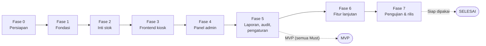

# Rencana Fase Pengembangan: Sistem Peminjaman & Inventaris Barang Tim IT

Diturunkan dari **PRD bagian 6.13 (Roadmap)**, dengan rincian tambahan dari 6.4 (Scope), 6.6 (FR), Tahap C, Tahap D, dan Tahap E. Butir bertanda **[U]** adalah penempatan atau usulan dari saya yang belum tertulis eksplisit di PRD.

---

## 1. Jawaban singkat: sampai fase berapa?

**Ada 8 fase, dari Fase 0 sampai Fase 7. Proyek selesai di Fase 7.**

| Tonggak | Selesai di | Artinya |
|---|---|---|
| Sistem inti sudah bisa dipakai (semua fitur **Must**) | **Fase 5** | MVP: peminjaman, klaim, verifikasi, login admin, kelola barang, laporan PDF, buku besar, audit |
| Seluruh cakupan PRD v5.0 (termasuk **Should** dan **Could**) | **Fase 6** | Ditambah pemesanan, perpanjangan, pembatalan, koreksi, stok rusak |
| Siap dipakai di kantor | **Fase 7** | Pengujian penuh, dokumentasi setup, uji penerimaan, migrasi data lama bila ada |

Keputusan di Tahap C: **semua fitur tetap dibangun**. Pembagian Must/Should hanya menentukan urutan, bukan pemangkasan. Jadi target akhirnya adalah Fase 7, bukan Fase 5.

### Posisi saat ini

PRD, Tahap C, dan Tahap D sudah ditulis, tetapi **belum ada kode Laravel**. Posisi proyek: **Fase 0 (persiapan), belum dimulai**.

---

## 2. Peta fase

| Fase | Nama | Kategori | Hasil akhir fase | Status |
|---|---|---|---|---|
| 0 | Persiapan | Persiapan | Lingkungan siap, keputusan tercatat | ☐ Belum dimulai |
| 1 | Fondasi | MVP | Skema ada, login admin berfungsi | ☐ |
| 2 | Inti stok | MVP | BR-01 lolos pada uji | ☐ |
| 3 | Frontend | MVP | Alur peminjaman dan klaim berjalan | ☐ |
| 4 | Panel admin | MVP | Alur admin lengkap | ☐ |
| 5 | Laporan, audit, pengaturan | MVP | Laporan sesuai filter | ☐ |
| 6 | Fitur lanjutan | Lanjutan | Seluruh cakupan v5.0 | ☐ |
| 7 | Pengujian dan rilis | Rilis | Siap dipakai | ☐ |

Aturan kerja: **fase berikutnya baru dimulai setelah gerbang (gate) fase sebelumnya lolos.** Gerbang adalah daftar "Selesai bila" di setiap fase di bawah.

---

## 3. Rincian per fase

### Fase 0: Persiapan

**Tujuan.** Memastikan lingkungan dan keputusan awal beres sebelum menulis kode.

**Yang dikerjakan**
- Verifikasi koneksi MySQL 8.4 di PHPBRO (menggunakan Adminer) ke database `inventaris_db`.
- Konfirmasi stack (Laravel + Vue) ke pemilik repo dan pengembang lain. AGENTS.md repo mewajibkan ini.
- Putuskan cara menjalankan aplikasi: Herd, PHPBRO (menggunakan Adminer), atau `php artisan serve`, lalu catat di panduan setup.
- Jawab pertanyaan terbuka PRD: pembagian MVP, nilai kebijakan, data lama, target kinerja.
- Baca `frontend/package.json` dan `backend/package.json`.
- Tentukan kategori dan divisi awal untuk seeder.
- Pulihkan atau buat ulang remote GitHub (repo lama terhapus).

**Keluaran.** Catatan keputusan, panduan menjalankan aplikasi, repo remote yang bisa di-push.

**Selesai bila**
- [x] `php artisan migrate:status` berhasil terhubung ke MySQL.
- [x] Pemilik repo sudah mengonfirmasi penyimpangan stack.
- [x] Satu cara menjalankan aplikasi dipilih dan tercatat.
- [x] `git fetch` berjalan tanpa error.

**Risiko terkait.** Penyimpangan dari keputusan tim; lingkungan campuran Herd + PHPBRO.

---

### Fase 1: Fondasi

**Tujuan.** Kerangka backend dan skema database lengkap, serta login admin yang aman.

**Yang dikerjakan** (sesuai Tahap E langkah 1 sampai 4)
- Proyek Laravel 13, `.env`, Sanctum mode SPA, sesi 15 menit, CORS, pembatas laju.
- Migration untuk **11 tabel domain** lengkap dengan CHECK dan kolom turunan (`nama_aktif`), lalu `migrate:fresh`. Tabel `settings`, `audit_logs`, dan `sessions` ikut dibuat.
- Model dan relasi, seeder (divisi, kategori, pengaturan delapan kunci).
- Perintah artisan `BuatAdmin` dan `ResetPasswordAdmin` (FR-20).
- Login, logout, `me`, middleware akun aktif (FR-11).
- Kerangka tes.

**FR yang tercakup.** FR-11, FR-20 (bagian perintah artisan).

**Keluaran.** Skema database lengkap, admin pertama dibuat lewat artisan, rute admin terlindungi.

**Selesai bila**
- [ ] T-5.1: buka rute admin tanpa login, dialihkan atau ditolak (401).
- [ ] U-05: password di database berupa hash.
- [ ] Sesi admin berakhir setelah 15 menit idle.
- [ ] Tidak ada kredensial di repo (G3).
- [ ] `composer install`, `.env`, `php artisan migrate --seed` berjalan dari repo bersih (G6).

---

### Fase 2: Inti stok

**Tujuan.** Logika bisnis paling kritis: stok hanya berubah lewat transaksi tervalidasi di server.

**Yang dikerjakan** (Tahap E langkah 5)
- `PeminjamanService`: kunci idempotensi, pengurangan `tersedia` bersyarat, kode `PJM-XXXXXX`, mutasi PINJAM.
- `KlaimService`: klaim parsial, sisa per barang, `hari_terlambat` dibekukan, kode `KMB-XXXXXX`.
- `VerifikasiService`: hasil baik/rusak/hilang/ditolak, buku besar, pemeriksaan BR-01 sebelum commit.
- `StatusPeminjaman`: status diturunkan dari data.
- Helper `Tanggal::hariIni()` dan `KodeAcak`.
- Perintah artisan `inventaris:periksa-invarian`.
- Buku besar `stock_movements` (FR-18).
- Endpoint kiosk dan admin untuk alur di atas.

**FR yang tercakup.** FR-02 (tanpa pemesanan), FR-04, FR-05, FR-06, FR-18, bagian backend FR-01.

**Keluaran.** API peminjaman, klaim, dan verifikasi yang sudah teruji.

**Selesai bila**
- [ ] **U-01:** dua permintaan serentak pada barang berstok 1, tepat satu berhasil (G2).
- [ ] **U-02:** form dikirim dua kali dengan kunci sama, hanya satu transaksi.
- [ ] **U-03:** 1.000 operasi acak, pemeriksa invarian melaporkan 0 pelanggaran (G1).
- [ ] **U-04:** transaksi gagal tidak meninggalkan data parsial.
- [ ] T-5.2, T-5.3, T-5.6 lolos.
- [ ] Contoh hitung: total 10, pinjam 3, klaim 2, verifikasi 1 baik + 1 rusak + hilang 1, hasilnya `tersedia 8`, `rusak 1`, `total 9`.

**Catatan.** Ini fase paling berisiko. Jangan lanjut ke Fase 3 sebelum BR-01 benar-benar lolos.

---

### Fase 3: Frontend kiosk

**Tujuan.** Peminjam dapat menyelesaikan alur lengkap lewat layar sentuh.

**Yang dikerjakan** (Tahap D)
- Setup Vue + Vite + Tailwind, klien axios, router, store.
- Layout: `LayoutKiosk`, `LayoutAdmin`, `LayoutLogin`.
- Komponen dasar: `TombolBesar`, `KartuBarang`, `BadgeStatus`, `BadgeLencana`, `InputJumlah`, `InputKode`, `FormField`, `ModalKonfirmasi`, `NotifikasiToast`, `StatusKosong`, `Memuat`, `PesanGalat`, `StrukCetak`.
- Layar kiosk: Beranda, Katalog, Form pinjam, Struk, Cek peminjaman, Kartu peminjaman, Klaim, Bukti klaim.
- Kunci idempotensi UUID di form, tombol kirim nonaktif saat memproses.
- Idle reset kiosk 60 detik (FR-21) **[U]**.
- Gaya cetak untuk struk.

**FR yang tercakup.** FR-01, FR-02, FR-04, FR-05, FR-21.

**Keluaran.** Alur kiosk pinjam dan klaim berjalan di browser.

**Selesai bila**
- [ ] **UI-01:** peminjam menyelesaikan peminjaman di layar sentuh.
- [ ] **UI-02:** klik cepat berulang hanya membuat satu transaksi.
- [ ] **UI-03:** kode pinjam tidak ada di URL, riwayat, maupun log akses.
- [ ] Kode salah berulang: terkunci setelah 5 kegagalan selama 5 menit.
- [ ] G4: form selesai hingga mendapat kode kurang dari 2 menit.
- [ ] UI-06 (struk) dan UI-07 (keadaan kosong dan memuat) lolos.

---

### Fase 4: Panel admin

**Tujuan.** Admin dapat mengelola data dan memverifikasi pengembalian dari panel.

**Yang dikerjakan** (Tahap E langkah 7 untuk sisi admin, Tahap D untuk UI)
- Layar: Login, Dasbor, Barang (+ form), Daftar peminjaman, Detail peminjaman, Antrean verifikasi, Verifikasi klaim, Kategori, Divisi.
- Komponen: `Sidebar`, `Navbar`, `TabelData`, `FilterBar`, `KartuAngka`, `LiniMasa`.
- Penyesuaian stok oleh admin dengan alasan (FR-13, bagian M).
- Soft-delete barang dengan penolakan bila masih dipinjam.
- Verifikasi: tombol Simpan aktif hanya bila selisih jumlah nol.
- Dasbor diperbarui tiap 30 detik.
- Halaman galat 403, 404, 419.

**FR yang tercakup.** FR-06 (UI), FR-11 (UI), FR-12, FR-13 (penyesuaian), FR-14, FR-15, FR-16.

**Keluaran.** Alur admin lengkap dari login sampai verifikasi.

**Selesai bila**
- [ ] T-5.3: klaim dan verifikasi lewat UI, stok sesuai, verifikasi ulang ditolak.
- [ ] T-5.4: status Terlambat dan jumlah hari dihitung server.
- [ ] T-5.5: hapus barang yang dipinjam ditolak, yang tidak dipinjam di-soft-delete.
- [ ] **UI-04:** badge status identik di kartu kiosk, tabel admin, dan detail.
- [ ] UI-05: tampil benar di lebar 360 px dan 768 px.
- [ ] UI-08: sesi habis mengarahkan ke login dengan pesan.
- [ ] Angka dasbor sama dengan data tabel.

---

### Fase 5: Laporan, audit log, pengaturan

**Tujuan.** Melengkapi fitur Must yang tersisa. **Akhir dari MVP.**

**Yang dikerjakan** (Tahap E langkah 8)
- Laporan PDF dibuat di server: rekap, belum dikembalikan, stok dan kondisi (FR-17), dengan judul, periode, waktu cetak, mengikuti filter.
- Halaman Jejak audit, hanya baca (FR-18).
- Halaman Pengaturan delapan parameter dengan validasi rentang (FR-19).
- Halaman Akun admin: tambah, nonaktifkan, ganti password (FR-20).
- Gaya cetak laporan.

**FR yang tercakup.** FR-17, FR-18 (UI), FR-19, FR-20 (UI).

**Keluaran.** Sistem dengan semua fitur Must.

**Selesai bila**
- [ ] **G5:** tiga PDF sesuai data dan filter.
- [ ] Nilai pengaturan baru langsung berlaku di validasi.
- [ ] Setiap aksi penting menulis baris `audit_logs`.
- [ ] UI-06: laporan tercetak tanpa sidebar dan navbar.

> **Titik MVP.** Setelah Fase 5, sistem sudah bisa menggantikan buku catatan untuk alur dasar (pinjam hari ini, klaim, verifikasi). Pemesanan, perpanjangan, dan koreksi belum ada.

---

### Fase 6: Fitur lanjutan

**Tujuan.** Melengkapi seluruh cakupan PRD v5.0.

**Yang dikerjakan** (Tahap E langkah 6)
- `PembatalanService`: pembatalan oleh peminjam (sebelum tanggal pinjam) dan admin (belum ada klaim, alasan wajib) (FR-03, FR-09).
- Pemesanan: tanggal pinjam masa depan, stok langsung ditahan, batas `maks_booking_hari` (FR-03).
- `PerpanjanganService`: oleh peminjam dan admin, kuota dan aturan `boleh_diperpanjang` (FR-07, FR-08).
- `KoreksiService`: koreksi data dan jumlah, riwayat di `loan_corrections` (FR-10).
- `StokService` lanjutan: tandai rusak, perbaikan selesai, afkir, halaman Stok rusak (FR-13, bagian S).
- Layar kiosk: Perpanjangan, Bukti perpanjangan, Batalkan pemesanan.
- Ekspor CSV/Excel (FR-22) **[U]**.

**FR yang tercakup.** FR-03, FR-07, FR-08, FR-09, FR-10, FR-13 (S), FR-22.

**Keluaran.** Seluruh fitur PRD v5.0 berjalan.

**Selesai bila**
- [ ] Pembatalan mengembalikan stok dan tercatat di buku besar.
- [ ] Pemesanan tidak bisa diperpanjang (BR-26); perpanjangan melebihi kuota ditolak untuk peminjam.
- [ ] Koreksi jumlah ditolak bila barang itu sudah punya klaim.
- [ ] Afkir mengurangi `total` dan `rusak`, mutasi AFKIR tercatat.
- [ ] **U-03 diulang** dengan operasi baru ikut diacak: tetap 0 pelanggaran.
- [ ] Berkas CSV/Excel terbuka dan isinya sesuai.

---

### Fase 7: Pengujian penuh dan rilis

**Tujuan.** Memastikan sistem benar, aman, terdokumentasi, dan siap dipakai.

**Yang dikerjakan**
- Menjalankan seluruh skenario uji: T-5.1 sampai T-5.6, U-01 sampai U-08, UI-01 sampai UI-08.
- Uji kinerja: halaman daftar kurang dari 2 detik pada 5.000 transaksi, transaksi peminjaman kurang dari 1 detik.
- Pemeriksaan keamanan: `APP_DEBUG=false`, akun database berhak minimal, MySQL hanya 127.0.0.1, `.env` dan dump SQL tidak di Git, uji `<script>` (U-06).
- Uji di Chrome dan Edge terbaru, tablet untuk kiosk, ponsel untuk admin (U-08).
- Panduan setup PHPBRO (Adminer), panduan backup (mysqldump terjadwal dan uji pulih), penanggung jawab utama dan pengganti.
- Uji penerimaan pengguna (UAT) oleh peminjam dan admin.
- Migrasi data lama dari PostgreSQL ke MySQL, **hanya bila** data asli ditemukan. Jangan menimpa data lama.
- Keputusan cara penyajian produksi (`npm run build`, disalin ke `backend/public` atau dilayani terpisah).
- Pembersihan sisa bawaan di backend (`resources/views`, `resources/js`).

**Keluaran.** Sistem siap dipakai, dokumentasi lengkap.

**Selesai bila**
- [ ] Semua skenario uji di 6.11 dan UI lolos.
- [ ] Target kinerja tercapai.
- [ ] UAT disetujui pengguna.
- [ ] Backup dan uji pulih berhasil dijalankan sekali.
- [ ] Firewall membatasi akses port aplikasi ke jaringan kantor.

---

## 4. Pemetaan fitur ke fase

| FR | Fitur | Prioritas | Fase |
|---|---|---|---|
| FR-01 | Katalog dan cek stok | M | 2 (API), 3 (UI) |
| FR-02 | Form peminjaman | M | 2, 3 |
| FR-03 | Pemesanan dan pembatalan | S | 6 |
| FR-04 | Cek peminjaman dengan kode | M | 2, 3 |
| FR-05 | Klaim pengembalian parsial | M | 2, 3 |
| FR-06 | Verifikasi klaim | M | 2 (API), 4 (UI) |
| FR-07 | Perpanjangan oleh peminjam | S | 6 |
| FR-08 | Perpanjangan oleh admin | S | 6 |
| FR-09 | Pembatalan oleh admin | S | 6 |
| FR-10 | Koreksi peminjaman | S | 6 |
| FR-11 | Login admin | M | 1 (API), 4 (UI) |
| FR-12 | Kelola barang | M | 4 |
| FR-13 | Penyesuaian stok, rusak, afkir | M/S | 4 (penyesuaian), 6 (rusak, afkir) |
| FR-14 | Kategori dan divisi | M | 4 |
| FR-15 | Daftar dan detail peminjaman | M | 4 |
| FR-16 | Dasbor | M | 4 |
| FR-17 | Laporan PDF | M | 5 |
| FR-18 | Buku besar dan audit log | M | 2 (buku besar), 5 (UI audit) |
| FR-19 | Pengaturan parameter | S | 5 |
| FR-20 | Akun admin | M | 1 (artisan), 5 (UI) |
| FR-21 | Idle reset kiosk | C | 3 **[U]** |
| FR-22 | Ekspor CSV/Excel | C | 6 **[U]** |

Catatan penempatan: FR-19 dan FR-21 berprioritas Should/Could tetapi saya tempatkan lebih awal karena sudah punya tempat alami (UI pengaturan di Fase 5, idle reset menyatu dengan layout kiosk di Fase 3). Ini tidak tertulis di PRD dan bisa digeser.

---

## 5. Pemetaan tujuan produk (G1 sampai G6) ke fase

| Tujuan | Terbukti di |
|---|---|
| G1: stok selalu konsisten | Fase 2, diulang di 6 dan 7 |
| G2: tidak ada pinjam melebihi stok | Fase 2 |
| G3: akses admin aman | Fase 1, diperiksa ulang di 7 |
| G4: peminjaman kurang dari 2 menit | Fase 3, UAT di 7 |
| G5: laporan dapat diandalkan | Fase 5 |
| G6: mudah dipasang | Fase 1, diverifikasi di 7 |

---

## 6. Ketergantungan antarfase

- **Fase 2 butuh Fase 1.** Service memakai tabel dan model yang dibuat di Fase 1.
- **Fase 3 butuh Fase 2.** UI kiosk memanggil API yang dibuat di Fase 2.
- **Fase 4 butuh Fase 1 dan 2.** Login, verifikasi, dan data barang.
- **Fase 5 butuh Fase 4.** Laporan memakai filter dan data yang sama dengan daftar admin.
- **Fase 6 butuh Fase 2.** Pembatalan, perpanjangan, dan koreksi memakai pola penguncian yang sama dengan Fase 2.
- **Fase 7 butuh semua fase sebelumnya.**

Fase 3 dan Fase 4 bisa dikerjakan bergantian bila ada dua orang, selama API Fase 2 sudah stabil **[U]**.

---

## 7. Risiko utama per fase

| Fase | Risiko | Penanganan |
|---|---|---|
| 0 | Stack berbeda dari keputusan tim | Konfirmasi dulu, bangun di folder atau repo terpisah |
| 1 | CHECK constraint tidak didukung Blueprint | `DB::statement` di migration, cek versi MySQL saat start |
| 2 | Race condition stok, deadlock | `lockForUpdate` urut id menaik, 3 percobaan ulang untuk galat 1213 dan 1205 |
| 3 | Kode pinjam bocor lewat URL atau log | Kirim di badan permintaan, bukan di URL |
| 4 | Status berbeda antar layar | Satu komponen `BadgeStatus` |
| 5 | PDF tidak sesuai filter | Dibuat di server dari data yang sama dengan daftar |
| 6 | Fitur lanjutan merusak invarian | Ulangi U-03 dengan semua operasi baru |
| 7 | Data lama tidak ditemukan atau ejaan divisi beragam | Tanyakan sumber data lebih awal (Fase 0), satukan ejaan sebelum dipetakan |

---

## 8. Lacak kemajuan

Ubah kotak di tabel ini saat sebuah fase lolos gerbangnya.

| Fase | Gerbang lolos | Tanggal | Catatan |
|---|---|---|---|
| 0 | ☐ | | |
| 1 | ☐ | | |
| 2 | ☐ | | |
| 3 | ☐ | | |
| 4 | ☐ | | |
| 5 (MVP) | ☐ | | |
| 6 | ☐ | | |
| 7 (rilis) | ☐ | | |

---

## 9. Hubungan dengan istilah "Tahap" di PRD

PRD memakai dua penomoran yang berbeda dan mudah tertukar:

| Istilah | Arti | Contoh |
|---|---|---|
| **Tahap A sampai E** | Tahap penulisan dokumen dan perancangan | Tahap B = PRD, Tahap C = database dan arsitektur, Tahap D = UI/UX, Tahap E = mulai menulis backend |
| **Fase 0 sampai 7** | Fase pengembangan aplikasi (roadmap 6.13) | Fase 2 = inti stok |

Tahap A sampai D sudah selesai sebagai dokumen. **Tahap E dimulai bersamaan dengan Fase 0 sampai 2**, dan setelah itu pengembangan mengikuti Fase 3 sampai 7.