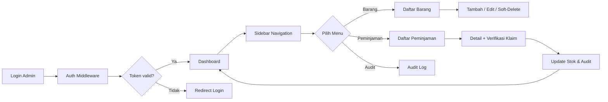

# Phase 4 – Panel Admin

## 🎯 Tujuan
Menyelesaikan UI dan backend panel admin sehingga administrator dapat **mengelola barang**, **memverifikasi klaim**, **melakukan penyesuaian stok**, **mengatur kategori & divisi**, serta **mengakses dasbor** yang selalu ter‑update.

## 📦 Hasil Akhir (Deliverables)
1. **Rute API** (`/api/admin/*`) dengan middleware `auth:sanctum` + `check.active`.
2. **Komponen UI Vue** lengkap (sidebar, navbar, tabel, filter, badge status, dll).
3. **Artisan commands** (jika diperlukan) untuk migration & seed admin.
4. **Unit / Feature tests** untuk tiap endpoint dan UI critical path.
5. **Dokumentasi** singkat cara menambah/menon‑aktifkan admin di README.

## 📋 Daftar Pekerjaan (Tasks)
| No | Kategori | Deskripsi | FR terkait | Estimasi |
|----|----------|-----------|------------|----------|
| 1 | Backend | Buat **middleware `CheckActive`** yang memblokir akun non‑aktif (403). | FR‑11, FR‑13 (penyesuaian stok) | 2 jam |
| 2 | Backend | Tambahkan **policy** `ItemPolicy` & `LoanPolicy` untuk authorisasi admin (view, edit, delete). | FR‑11 | 1 jam |
| 3 | Backend | Implementasi **API CRUD** untuk `Item`, `Category`, `Division` (soft‑delete). | FR‑12, FR‑14, FR‑15 | 4 jam |
| 4 | Backend | Endpoint **verifikasi klaim** (`POST /api/admin/loans/{id}/verify`). Validasi `selisih = 0` sebelum menyimpan. | FR‑06, FR‑13 (penyesuaian stok) | 3 jam |
| 5 | Backend | Endpoint **penyesuaian stok** (`POST /api/admin/items/{id}/adjust`) dengan alasan perubahan. Catat di `audit_logs`. | FR‑13 (bagian M) | 2 jam |
| 6 | Backend | Endpoint **soft‑delete barang** (`DELETE /api/admin/items/{id}`) – cek tidak ada peminjaman aktif. | FR‑13 (bagian S) | 2 jam |
| 7 | Frontend | Buat **layout admin** (`LayoutAdmin.vue`) – sidebar, navbar, footer. | UI‑01‑admin | 3 jam |
| 8 | Frontend | Komponen **TabelData**, **FilterBar**, **BadgeStatus**, **Pagination**. | UI‑02‑admin | 4 jam |
| 9 | Frontend | Halaman **Login Admin** – integrasi Sanctum, redirect ke `/admin/dashboard`. | FR‑11 | 2 jam |
|10 | Frontend | Dashboard **KartuAngka** (total barang, pinjaman aktif, klaim pending, stok rusak). Refresh otomatis tiap 30 detik. | FR‑16 | 3 jam |
|11 | Frontend | Halaman **Daftar Barang** dengan tombol **Tambah**, **Edit**, **Hapus** (soft). | FR‑12 | 4 jam |
|12 | Frontend | Halaman **Daftar Peminjaman** – filter, detail, tombol **Verifikasi Klaim**. | FR‑15, FR‑06 | 4 jam |
|13 | Frontend | Halaman **Audit Log** (read‑only) – pagination, pencarian. | FR‑18 | 2 jam |
|14 | Testing  | **Feature test** untuk semua endpoint admin (status 200/403, validasi). | semua FR admin | 3 jam |
|15 | Testing  | **E2E test** (Cypress) untuk alur login → dashboard → verifikasi klaim. | UI‑04, UI‑05 | 4 jam |
|16 | Docs     | Update `README.md` dengan **Panduan Admin** (setup, login, menambah admin). | – | 1 jam |

## 🧩 Relasi ke Fase Lain
- **Dependensi ke Fase 2**: Memerlukan tabel `items`, `categories`, `divisions`, `loans`, `audit_logs` yang sudah ada.
- **Output untuk Fase 5**: Dashboard menyiapkan data untuk laporan PDF; endpoint audit log dipakai di laporan.
- **Input dari Fase 1**: Middleware `CheckActive` dan **login admin** (sanctum) sudah ada.

## ✅ Gerbang Penyelesaian (Gate Criteria)
- [ ] Semua endpoint admin mengembalikan **HTTP 401** bila token tidak ada atau **403** bila akun non‑aktif.
- [ ] **Soft‑delete** barang menolak bila ada peminjaman aktif (U‑03).
- [ ] Badge status konsisten di **kartu kiosk**, **tabel admin**, dan **detail peminjaman** (UI‑04).
- [ ] Dashboard menampilkan angka yang **cocok** dengan data tabel (U‑05).
- [ ] UI responsif pada **360 px** (mobile) dan **768 px** (tablet) (UI‑05).
- [ ] Sesi admin **kedaluwarsa** setelah 15 menit idle, diarahkan ke halaman login dengan pesan (UI‑08).
- [ ] Semua tes (`php artisan test`) **lulus** (coverage > 80 %).

## ⚡️ Risiko Utama & Mitigasi
| Risiko | Dampak | Mitigasi |
|--------|--------|----------|
| **Race condition** saat penyesuaian stok oleh admin bersamaan dengan layanan peminjaman (Fase 2). | Data stok tidak konsisten (G1). | Gunakan **DB transaction** + `lockForUpdate` pada baris stok; rollback bila verifikasi gagal. |
| **Soft‑delete** barang yang masih dipinjam. | Peminjaman menjadi orphan, melanggar BR‑01. | Validasi di endpoint `DELETE` – jika ada `loans` dengan `status != returned` maka tolak dengan pesan 409. |
| **UI tidak sinkron** antara sidebar & konten (badge status). | Kebingungan admin, UI‑04 gagal. | Buat **global store (Vuex/Pinia)** yang menampung status barang; semua komponen membaca dari store. |
| **Token Sanctum tidak ter‑refresh** sehingga sesi kadaluarsa tiba‑tiba. | Admin ter‑logout tanpa peringatan (UI‑08). | Tambahkan interceptor Axios yang menangkap `401` dan mengarahkan ke login dengan toast. |

## 📐 Diagram Alur (Mermaid)

## 📁 File yang Akan Ditambahkan / Diubah
| Path | Tipe | Keterangan |
|------|------|------------|
| `app/Http/Middleware/CheckActive.php` | New | Middleware cek `active` flag pada user.
| `app/Policies/ItemPolicy.php` | New | Authorisasi admin.
| `app/Http/Controllers/Admin/ItemController.php` | New | CRUD + soft‑delete.
| `app/Http/Controllers/Admin/LoanController.php` | New | Verifikasi klaim.
| `routes/api.php` | Edit | Tambah grup `prefix('admin')` dengan middleware.
| `resources/js/components/admin/*.vue` | New | Layout, tabel, filter, badge, dll.
| `tests/Feature/Admin/*Test.php` | New | Feature tests.
| `tests/E2E/admin_spec.js` | New | Cypress E2E.
| `README.md` | Edit | Tambah bagian *Admin Setup*.

---
> **[!NOTE]** Semua nama file dan namespace mengikuti konvensi Laravel 10 & Vue 3. Pastikan `composer dump‑autoload` dan `npm run dev` dijalankan setelah menambah file.

> **[!IMPORTANT]** Pastikan **audit log** dibuat melalui helper `Audit::log($action, $model)` sehingga histori tetap konsisten.

---
*Jika ada tambahan atau perubahan prioritas, beri tahu saya agar saya dapat menyesuaikan task list atau langsung mulai meng‑implementasikan bagian tertentu.*